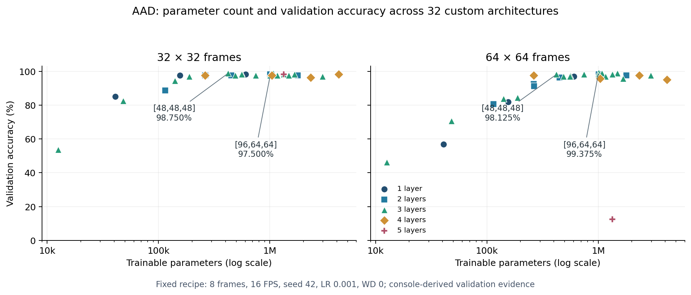

# AAD search results and comparison shortlist

Reviewed 13 October 2026. Source: the 10–11 October Colab console output at
revision `bc3d8fb`, preserved in [the raw log](latest_colab_results.raw.txt).
This report uses AAD only: 1,069 videos, 11 classes, and the existing
748/160/161 train/validation/test split. Test results are still unavailable.

The log records **131 completed stage entries: 127 fresh trainings and four
exact-configuration reuses**. The advertised 142 was a maximum budget, not a
completed count. The search covered 32 distinct custom architectures. It
finished, but the later comparison stopped during its preparatory recipe run
at epoch 64/256. Although a 6.72 GB ZIP was generated, its download was not
verified; the corresponding Colab checkpoints, histories and JSON files have
not been recovered locally.

## Table 1 — strongest observed custom search configurations

One row per distinct architecture, using its best **seed-42** result from the
base architecture search, ordered by validation accuracy, loss, then parameter
count. All rows use eight frames at 16 FPS, 3×3 kernels, LR 0.001, weight decay
0, and augmentation off; the search budget was up to 256 epochs. Frame sizes
are shown because each architecture's best input can differ. This ranking
describes configurations, not an isolated causal effect of architecture.

P/R/F1 below pool TP/FP/FN across all 11 classes. For this single-label task they
equal accuracy; the 127 logged sets of per-class counts reconcile with the
printed accuracy. These are reconstructed validation metrics, not recovered
prediction-file evidence. [Metric definition](https://scikit-learn.org/stable/modules/generated/sklearn.metrics.classification_report.html).

| Rank | Filters per layer | Frame size | Acc (%) | P (%) | R (%) | F1 (%) | Val loss | Parameters |
|---:|---|---:|---:|---:|---:|---:|---:|---:|
| 1 | **[96,64,64]** | 64×64 | **99.375** | 99.375 | 99.375 | 99.375 | 0.297710 | 1,007,307 |
| 2 | [32,64,64] | 32×32 | 98.750 | 98.750 | 98.750 | 98.750 | 0.170426 | 557,771 |
| 3 | [64,96,64] | 32×32 | 98.750 | 98.750 | 98.750 | 98.750 | 0.179411 | 1,077,579 |
| 4 | **[48,48,48]** | 32×32 | **98.750** | 98.750 | 98.750 | 98.750 | 0.189388 | **421,019** |
| 5 | [64,128,64] | 64×64 | 98.750 | 98.750 | 98.750 | 98.750 | 0.258579 | 1,483,211 |
| 6 | [64,64,128] | 64×64 | 98.750 | 98.750 | 98.750 | 98.750 | 0.290738 | 1,336,459 |
| 7 | [128,64,64] | 32×32 | 98.125 | 98.125 | 98.125 | 98.125 | 0.149044 | 1,342,667 |
| 8 | [64,64,32] | 32×32 | 98.125 | 98.125 | 98.125 | 98.125 | 0.155748 | 560,875 |
| 9 | [64,64,64,64,64] | 32×32 | 98.125 | 98.125 | 98.125 | 98.125 | 0.167842 | 1,336,011 |
| 10 | [96,96,96] | 32×32 | 98.125 | 98.125 | 98.125 | 98.125 | 0.176060 | 1,671,467 |

The search identifies several compact configurations with similar validation
performance. The early-wide `[96,64,64]` model correctly classified 159 of 160
validation clips, while `[48,48,48]` classified 158 using 58.2% fewer parameters.
Their inputs differ, so this is an observed configuration tradeoff. At the
common 64×64 input, their seed-42 accuracies are 99.375% and 98.125%, respectively.
The three-layer flat and shaped stacks merit final comparison, but a one-clip
difference should not be presented as conclusive superiority.

Strict accuracy/loss ranking gives ranks 1–5. For the requested variety, the
recommended five-model shortlist is **[96,64,64], [32,64,64], [64,96,64],
[48,48,48], and [64,64,128]**. It substitutes rank 6 for rank 5 to include
late-layer widening, with the same peak accuracy, fewer parameters and
second-seed evidence. Describe this as a representative shortlist, not the
literal five highest-ranked rows. The 99.375% model is retained.

Second-seed checks at the shortlisted models' displayed best sizes:

- `[96,64,64]`, 64×64: 99.375% / 98.125% for seeds 42 / 2026.
- `[32,64,64]`, 32×32: 98.750% / —; its second-seed check is missing.
- `[64,96,64]`, 32×32: 98.750% / 98.750%.
- `[48,48,48]`, 32×32: 98.750% / 97.500%.
- `[64,64,128]`, 64×64: 98.750% / 98.125%.

## Table 2 — planned final comparison on AAD test data

Plan update, 13 October: the owner will first rerun the focused search in
ticket 077. The roster/input below remain an illustration from the earlier
report; ticket 076 will use the new verified finalists and frozen input.
`[96,64,64]` stays a prespecified comparison candidate, with its true rerun rank
disclosed. Every test value remains unavailable.

All ten models must be trained afresh at a common declared input and budget,
selected using validation, and frozen before the 161-clip test is evaluated.
The proposed starting recipe matches the 99.375% search configuration:
**eight frames, 64×64, 16 FPS, LR 0.001, weight decay 0, augmentation off,
model seed 42 and the unchanged split**. It replaces the unfinished 16-frame
transfer attempt; it does not inherit that attempt's unfinished results.

| Model | Parameters | Test acc (%) | Test P (%) | Test R (%) | Test F1 (%) | Test loss |
|---|---:|---:|---:|---:|---:|---:|
| Custom [96,64,64] | 1,007,307 | — | — | — | — | — |
| Custom [32,64,64] | 557,771 | — | — | — | — | — |
| Custom [64,96,64] | 1,077,579 | — | — | — | — | — |
| Custom [48,48,48] | 421,019 | — | — | — | — | — |
| Custom [64,64,128] | 1,336,459 | — | — | — | — | — |
| PaperConvLSTM, input-adapted | 134,415,195† | — | — | — | — | — |
| R3D-18 | 33,171,915 | — | — | — | — | — |
| MC3-18 | 11,495,883† | — | — | — | — | — |
| Video Swin-T | 27,858,929 | — | — | — | — | — |
| Video Swin-S | 49,517,537† | — | — | — | — | — |

This table will compare the selected custom architectures with recurrent,
3D-convolutional and transformer baselines under a shared AAD protocol.
Every dash represents an unavailable final test result. The earlier R3D/Swin
search scores are not substituted for this fresh comparison. The best custom
example model must be chosen using validation; the final test need not favour
a custom model. Save a test confusion matrix for every model and playable
correct/incorrect examples from the validation-selected best custom.

† These are static 11-class parameter counts, not training results. MC3-18 and
Swin-S were counted with the repository wrappers on a meta device. The adapted
paper count follows its dense-layer formula at 8×64×64. Changing the input
changes that classifier, so label it **input-adapted published topology**;
the native 50-frame/50×50 topology has 512,197,467 trainable parameters.

## Interpreting the capacity boundary

The defensible finding is an **accuracy–parameter tradeoff within the searched
AAD configurations**: moderate three-layer stacks approach the best observed
accuracy, and increasing width or depth does not consistently improve it.
`[48,48,48]` is a strong compact candidate; `[96,64,64]` is the highest observed
seed-42 configuration. This does not establish a unique or global optimum.
The five-layer 64-wide stack reached 98.125% at 32×32 but collapsed to 12.5%
at 64×64, while Swin-T predicted one class throughout its checks. Those outcomes
suggest optimization failure. Some matched train/validation evaluations show
generalization gaps, but the lost curves prevent a claim that all larger models
overfit. A stronger overfitting claim requires matched checkpoint metrics and
learning curves from the new comparison.

The [SVG figure](latest_colab_accuracy_parameters.svg) separates frame sizes
into two panels, places parameter count on a logarithmic x-axis and validation
accuracy on y, and encodes layer count by marker/colour. Width placement stays
in the architecture labels and tables; no extra dimensions are needed.

## What remains before manuscript revision

This is promising AAD validation evidence for the planned study, but it is not
yet a complete journal result. Repeated selection on the same small validation
set can bias the best observed score; final evaluation must follow a frozen
selection. [Cawley and Talbot's model-selection study](https://www.jmlr.org/papers/v11/cawley10a.html)
explains this problem. Keep the contribution scoped to AAD and acknowledge that
the current clip split does not independently establish subject/scene separation.

Next: [077 — focused A100 rerun](../../../../../agents/work/077-focused-aad-colab-rerun/prompt.md):
16 architectures, two frame sizes and two FPS values, with 64 balanced jobs.
It preserves width-64 depths 1–5, a flat three-layer width ladder, and widening
at different layer positions. The new notebook/export stays thin and uses the
modular runner. Input-stability ranking measures preprocessing sensitivity;
it does not establish unseen-dataset generalization. Compact result bundles
are saved during execution, with checkpoint bundles separate.

Then [076 — fixed finalist comparison](../../../../../agents/work/076-aad-shortlist-comparison/prompt.md)
trains five finalists and five baselines once longer at a common frozen input
and recipe, saves artifacts, and updates this report after owner execution.
Use the A100; local 6 GB execution requires full-step memory checks. The native paper model cannot train with FP32
Adam on 6 GB: weights, gradients and optimizer states alone exceed 7.6 GiB.
The proposed adapted eight-frame model reduces that lower bound to about
2.0 GiB, but its actual safe batch and runtime still need measurement.
The existing JSON mode accepts only three customs, so five customs require
a small runner/validation extension, not just another JSON filename.

[078 — ablation figures](../../../../../agents/work/078-aad-ablation-figures/prompt.md)
will try tally/cross markers for layer count, shared size/FPS panels and
controlled width/depth/placement curves. Figures can lead the results narrative;
the top-ten table and complete CSV provide supporting detail. The existing
figures/data are preserved. The current notebook still runs the old workflow;
implement 077 before starting the planned rerun.

Recover the original search ZIP if it remains available. If it is lost, keep
Table 1 labelled console-derived and rerun any search configurations required
to support final manuscript claims; new comparison files cannot reconstruct
the old checkpoints or curves. Swin-T's constant-class behaviour must also be
resolved or reported as an optimization limitation before claiming superiority
over transformers. No Kinetics or VDD result is used here.

Use the top-ten table in the paper and the full
[131-entry CSV](latest_colab_search_all.csv) as supplementary material instead
of a 140-row appendix. The [top-ten CSV](latest_colab_search_top10.csv) records
shortlist membership and source lines. Raw-source SHA-256:
`1fb637c16075ebcfff587611123be66311d4de5f92014c16ed1711f34d892e63`.
