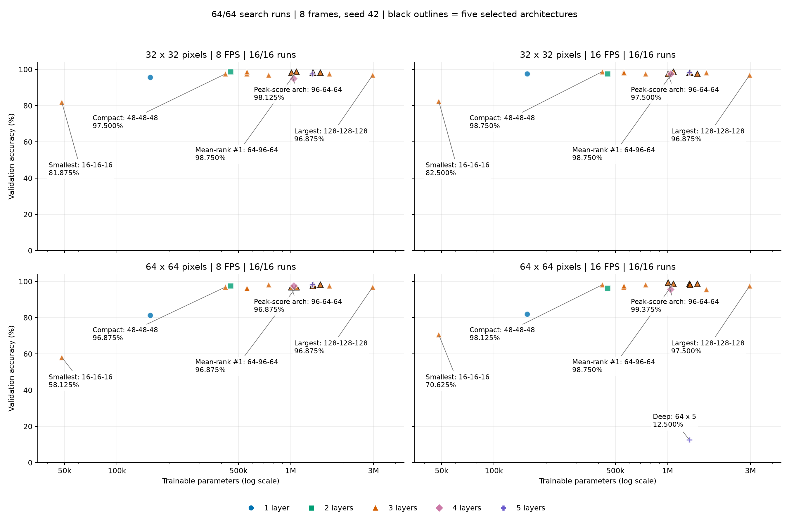
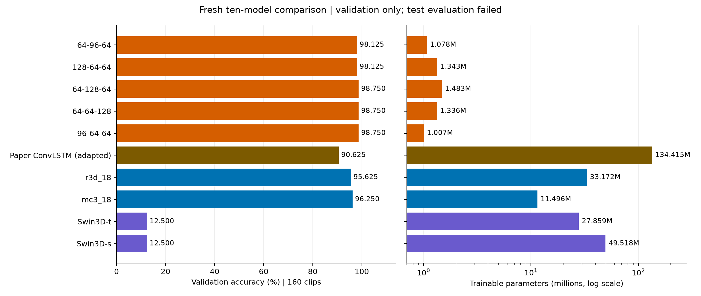

# AAD focused run: search and comparison preview

Review: 14 October 2026. Execution timestamps: 14 October 2026, timezone not
verified. Code: `e269ae5`; GPU: NVIDIA A100-SXM4-80GB. **Validation results only.**
The original contents of this README are preserved byte-for-byte in
[colab_console.raw.txt](colab_console.raw.txt); the supplied
[essential ZIP](aad_results_essential.zip) is unchanged.
Update: the newly imported `runs/` files now independently corroborate all
64 console-derived search rows, including their summaries, histories and
images. The search ranking is unchanged. No new final test result was found.

## 1. What finished, and what the results mean

**All 64 search jobs and ten fresh comparison trainings finished. However,
the first final test evaluation failed at checkpoint compatibility checking.**
No final test score or test prediction example is available in the supplied evidence.
Download the approximately **23 MB comparison `artifacts.zip` before Colab closes**;
the exact path and checkpoint warning are in section 4.

- Best single search result: **[96,64,64], 99.375% validation accuracy**
  (159/160 clips), at 64px/16 FPS. This is not its comparison/test score.
- Best search architecture averaged equally over four input conditions:
  **[64,96,64], 98.28125%**. All five selected architectures have three layers.
- Fresh comparison: **[64,128,64] wins the accuracy/loss selection rule**,
  at **98.750%**, loss **0.2586**, with **1,483,211 parameters**.
- [64,64,128] and [96,64,64] also achieve **98.750%**. Of these tied models,
  **[96,64,64] is smallest: 1,007,307 parameters**. Do not silently replace
  the frozen winner with the smaller model after looking at test results.
- Both transformers predict only **Begging**: **12.500% validation accuracy**.
  That is a failed learning outcome under this recipe, not a convincing estimate
  of the transformer family's best performance.

The result is encouraging, but repeating seed 42 on the same split is not
independent confirmation. One validation clip changes accuracy by **0.625
percentage points**; the small differences among finalists are not established
statistical superiority. We have a useful capacity region, not a proven optimum.

Git check: local `master` is one commit ahead because `f431de2` creates tickets
079–082 and was committed without a push. Remote `master` was verified at
`e269ae5`, which is also the run's logged code revision. The experiment code
was published; the extra commit was planning documentation. The initial review
did not commit, push, modify notebooks, or change the manuscript/training code.

Publication update: the owner subsequently requested committing/pushing this
review and planning [083 comparison-only recovery](../../../../../agents/work/083-comparison-only-recovery/prompt.md).
That next ticket preserves search results, investigates transformer convergence
and prepares the comparison-only script; no new experiment implementation or
training is included in this report commit.

## 2. Search: all 64 runs, grouped into four panels



Each panel has all 16 architectures: x = trainable parameters (log scale),
y = validation accuracy, colour/marker = recurrent depth. Black outlines mark
the five selected architectures. **64/64 runs are plotted, 16/16 per panel**;
none are filtered out. Only the smallest/largest models, three important
architectures and the five-layer collapse receive labels. Labels identify an
architecture's role; the percentage beside each is its score in that panel,
not its four-condition mean. Nearby points can overlap; the expandable table and
[64-row CSV](search_results.csv) retain every measurement. No failed-learning
run is omitted. [Vector figure](search_capacity.svg).

**[View all 64 runs' original images](search_run_gallery.md)**: expand any run
to see its training curves and validation confusion matrix (128 images total).
The gallery contains byte-identical report copies of the newly imported images
so it works on GitHub and another laptop. Original run files remain unchanged.

| Labelled architecture | Why it matters | Parameters |
|---|---|---:|
| 16-16-16 | Smallest tested | 48,187 |
| 48-48-48 | Strong compact alternative | 421,019 |
| 64-96-64 | Best mean across the four inputs | 1,077,579 |
| 96-64-64 | Highest single search score | 1,007,307 |
| 128-128-128 | Largest tested | 2,965,899 |

Protocol: AAD, 1,069 clips, 11 classes; 748 train / 160 validation / 161 locked
test. Eight frames throughout; 32/64px crossed with 8/16 FPS; seed 42; batch
32; Adam LR 0.001, weight decay 0, augmentation off, plateau scheduler.
Search cap 256 epochs, minimum 64, patience 24. Each checkpoint is selected
by lowest validation loss. Ranking uses mean validation accuracy, then worst
condition, mean loss, parameters and name. The four conditions are not four
independent seeds. This run does **not** ablate LR, weight decay or frame count.

<details>
<summary>Full search table: all 16 architectures x four inputs = 64 runs</summary>

| Rank | Architecture | Layers | Parameters | 32px/8FPS | 32px/16FPS | 64px/8FPS | 64px/16FPS | Mean % | Worst % |
|---:|---|---:|---:|---:|---:|---:|---:|---:|---:|
| 1 | 64-96-64 | 3 | 1,077,579 | 98.750 | 98.750 | 96.875 | 98.750 | 98.281 | 96.875 |
| 2 | 128-64-64 | 3 | 1,342,667 | 98.125 | 98.125 | 98.125 | 98.125 | 98.125 | 98.125 |
| 3 | 64-128-64 | 3 | 1,483,211 | 98.125 | 97.500 | 98.125 | 98.750 | 98.125 | 97.500 |
| 4 | 64-64-128 | 3 | 1,336,459 | 98.125 | 98.125 | 97.500 | 98.750 | 98.125 | 97.500 |
| 5 | 96-64-64 | 3 | 1,007,307 | 98.125 | 97.500 | 96.875 | 99.375 | 97.969 | 96.875 |
| 6 | 48-48-48 | 3 | 421,019 | 97.500 | 98.750 | 96.875 | 98.125 | 97.812 | 96.875 |
| 7 | 64-64-64 | 3 | 745,675 | 96.875 | 97.500 | 98.125 | 98.125 | 97.656 | 96.875 |
| 8 | 64-64-32 | 3 | 560,875 | 98.750 | 98.125 | 96.250 | 97.500 | 97.656 | 96.250 |
| 9 | 64-64 | 2 | 450,507 | 98.750 | 97.500 | 97.500 | 96.250 | 97.500 | 96.250 |
| 10 | 32-64-64 | 3 | 557,771 | 97.500 | 98.750 | 96.250 | 96.875 | 97.344 | 96.250 |
| 11 | 96-96-96 | 3 | 1,671,467 | 97.500 | 98.125 | 97.500 | 95.625 | 97.188 | 95.625 |
| 12 | 128-128-128 | 3 | 2,965,899 | 96.875 | 96.875 | 96.875 | 97.500 | 97.031 | 96.875 |
| 13 | 64-64-64-64 | 4 | 1,040,843 | 95.000 | 97.500 | 97.500 | 95.625 | 96.406 | 95.000 |
| 14 | 64 | 1 | 155,339 | 95.625 | 97.500 | 81.250 | 81.875 | 89.062 | 81.250 |
| 15 | 64-64-64-64-64 | 5 | 1,336,011 | 97.500 | 98.125 | 98.125 | 12.500 | 76.562 | 12.500 |
| 16 | 16-16-16 | 3 | 48,187 | 81.875 | 82.500 | 58.125 | 70.625 | 73.281 | 58.125 |

</details>

The first five are both the numerical top five and the actual comparison
finalists: no reserved-anchor substitution was necessary. The highest single
score does not determine the across-condition ranking. Loss tie-breaks are
reconstructed from printed precision; the resulting top five agree with the
console announcement, newly imported search selection receipt and archived
comparison configuration. All 64 full-precision source scores agree with the
printed scores within their rounding precision.

### Capacity, shape and the proposed turning point

- **Flat width at depth three:** mean accuracy rises from 73.281% at width 16
  to 97.8125% at width 48, then is 97.656%, 97.188% and 97.031% at widths
  64, 96 and 128. That is a sampled plateau/decline in the flat family,
  not evidence that every wider architecture overfits.
- **Depth at width 64:** means for one through five layers are 89.0625%,
  97.500%, 97.656%, 96.406% and 76.5625%. Depth five fails specifically
  at 64px/16 FPS, while achieving 97.500–98.125% elsewhere. Treat this as
  input-sensitive learning instability, not a universal five-layer limit.
- **Shape matters:** [64,96,64] has the best mean; [128,64,64] is consistently
  98.125% across all four conditions. Widening selected layers competes well
  without making every layer 128-wide. There is no universal best widening
  location across every input and training budget.
- **Efficiency alternative:** [48,48,48] is only 421,019 parameters and just
  0.469 percentage points below the best mean. Include it in a representative
  search table; do not hide it because it missed the top-five cutoff.
- **Input sensitivity:** 64px is not better for every architecture; one layer
  performs much worse there. The common 64px/16 FPS comparison input was
  chosen on the finalists, not on an assertion that it wins everywhere.

Low validation accuracy alone cannot establish underfitting, and falling
validation accuracy with size alone cannot establish overfitting. The newly
imported histories and matched training scores are now available for that
analysis; this minor update verifies them but does not infer a universal
underfit/overfit boundary. For a
main-paper search table, show the finalist five plus the flat-width and
width-64 depth controls above; keep every run in the appendix/CSV. Do not
select rows only because they illustrate a preferred U-shaped story.

## 3. Fresh ten-model comparison: validation, not test



All ten trained from scratch at the same selected **8-frame, 64x64, 16-FPS**
input and fixed recipe. Cap 512 epochs; minimum 128; patience 32. The cap is
not the actual number of epochs. `custom_top1`–`custom_top5` denote search
rank, not comparison rank. [Vector figure](comparison_validation.svg).
The winner is reconstructed from the archived scores using the documented
rule; the separate freeze receipt still needs to be recovered and checked.

| Model | Parameters | Correct/160 | Accuracy % | Loss | Macro P % | Macro R % | Macro F1 % |
|---|---:|---:|---:|---:|---:|---:|---:|
| top1: 64-96-64 | 1,077,579 | 157 | 98.125 | 0.2316 | 98.227 | 98.311 | 98.211 |
| top2: 128-64-64 | 1,342,667 | 157 | 98.125 | 0.3176 | 97.917 | 98.089 | 97.957 |
| top3: 64-128-64 | 1,483,211 | 158 | 98.750 | 0.2586 | 98.733 | 98.846 | 98.746 |
| top4: 64-64-128 | 1,336,459 | 158 | 98.750 | 0.2907 | 98.733 | 98.846 | 98.746 |
| top5: 96-64-64 | 1,007,307 | 158 | 98.750 | 0.2913 | 98.733 | 98.846 | 98.746 |
| Paper ConvLSTM, input-adapted | 134,415,195 | 145 | 90.625 | 1.2470 | 92.080 | 90.683 | 90.909 |
| R3D-18 | 33,171,915 | 153 | 95.625 | 0.2675 | 95.720 | 95.995 | 95.802 |
| MC3-18 | 11,495,883 | 154 | 96.250 | 0.2602 | 96.625 | 96.558 | 96.459 |
| Swin3D-T | 27,858,929 | 20 | 12.500 | 2.3843 | 1.136 | 9.091 | 2.020 |
| Swin3D-S | 49,517,537 | 20 | 12.500 | 2.3841 | 1.136 | 9.091 | 2.020 |

Accuracy is computed exactly from confusion counts; minor float32 differences
in archived accuracy are numerical representation, not different results.
The paper model is an **input-adapted baseline**, not an exact reproduction.

**Metrics clarification:** pooled/micro precision, recall and F1 equal
accuracy in this single-label multiclass task. They are not four independent
success indicators. Macro columns above give each of the 11 classes equal
weight; they are explicitly labelled, not raw class metrics. All **unaveraged
class precision/recall/F1, support, TP/FP/FN** are available in
[comparison_per_class.csv](comparison_per_class.csv), and all ten exact
11x11 validation confusion matrices are in [preview_results.json](preview_results.json).
Do not substitute any of these for missing test metrics.

The three 98.750% customs have the same aggregate confusion counts: one
Begging clip predicted as Hijack, and one Drunkenness clip as Knife Hazard.
This does not prove they failed on the identical individual clips; the
per-video prediction files are needed to check that. Their macro F1 values
match because their confusion counts match, not because the metric is broken.

| Model | Matched train acc % | Selected/actual epochs | Train min | Tensor MB | Forward ms/clip |
|---|---:|---:|---:|---:|---:|
| top1 | 100.000 | 301/333 | 23.11 | 4.31 | 6.12 |
| top2 | 100.000 | 243/275 | 22.66 | 5.37 | 6.06 |
| top3 | 100.000 | 203/235 | 18.85 | 5.93 | 6.32 |
| top4 | 100.000 | 172/204 | 15.05 | 5.35 | 6.14 |
| top5 | 100.000 | 281/313 | 21.48 | 4.03 | 6.08 |
| Paper adapted | 97.326 | 13/128 | 4.11 | 537.66 | 3.68 |
| R3D-18 | 100.000 | 102/134 | 2.58 | 132.73 | 3.22 |
| MC3-18 | 100.000 | 92/128 | 2.58 | 46.02 | 3.20 |
| Swin3D-T | 12.433 | 102/134 | 5.29 | 126.19 | 21.88 |
| Swin3D-S | 12.433 | 102/134 | 8.74 | 227.57 | 39.54 |

Timing: A100 80GB, FP32, batch one, three warmups/ten measurements, model-only
forward with input on GPU. These are not end-to-end video throughput or
deployment latency. Tensor MB includes saved model tensors/buffers, excludes
optimizer state, and is not checkpoint-file size. Custom models are smaller
but **not faster than the tested CNNs**. [Full efficiency CSV](comparison_validation.csv).
Training-time totals are about 10.10 hours for search and 2.07 hours for
comparison; they exclude some preparation/export/evaluation overhead.

### Why the transformers require caution

Both have 12.433% matched training accuracy (93/748) and 12.500% validation
accuracy (20/160), predicting Begging for every validation clip. Their macro
F1 is only 2.020%. This is consistent with constant-class optimization failure,
not classic high-training/low-validation overfitting.

The source explicitly constructs them with `weights=None`. The shared recipe
was selected for the custom search and is not evidence of transformer-specific
tuning. Limited training data, optimizer settings, initialization and small
inputs are hypotheses to audit, not established causes. There is no justified
expectation of 90% here. For context, Torchvision's pretrained Swin3D-T reference
uses Kinetics-400, 32-frame clips and 224px crops, not this from-scratch eight-frame
AAD experiment. [Official Torchvision 0.24 reference](https://docs.pytorch.org/vision/0.24/models/generated/torchvision.models.video.swin3d_t.html).

For publication, retain these outcomes, but do not claim that a collapsed
baseline establishes general superiority over transformers. Before a stronger
family-level claim, plan a separate validation-only convergence audit (including
input/gradient checks and a small-subset overfit check); any tuned/pretrained
control must be labelled separately and never selected using test scores.
This review does not run or change those experiments.

### Provisional paper wording

> Across 16 custom architectures evaluated at two resolutions and two sampling
> rates, three-layer non-uniform-width ConvLSTMs occupied the highest
> validation-ranked capacity region. The [64,96,64] architecture achieved
> 98.281% mean validation accuracy across four input conditions. Following
> fresh training under a common input and recipe, [64,128,64] achieved 98.750%
> validation accuracy with 1.483 million parameters, compared with 96.250%
> for MC3-18 and 95.625% for R3D-18. The smaller [96,64,64] matched its accuracy
> with 1.007 million parameters. Wider flat models and additional depth did
> not consistently improve performance. These single-seed, clip-split results
> indicate a promising accuracy–parameter trade-off; they do not establish a
> global optimum or source-independent generalization. Final held-out testing
> remains pending, and transformer convergence limits the cross-family claim.

This is preview wording, not a final manuscript result. Repeated use of this
validation split for search introduces selection optimism. Different filenames
or recordings do not establish subject/scene independence; preserve that
limitation and do not invent a clean underfit/overfit explanation.

## 4. Save these files before the runtime disappears

**Recovery update:** all 64 search summaries/histories and their 128 images
are now present locally, along with search selection and split files. Ten
comparison summaries/histories are also present. The comparison study's
standalone freeze receipt and checkpoint weights have not been recovered or
verified here. Retain the combined archive for those remaining records.

**Archive to retain (~23.3 MB):** this is
the comparison wrapper archive produced after the failed test attempt:

```text
/content/phd_research/papers/001-journal-abnormal-activity-recognition/implementation/runs/notebook_studies/comparison_20261014_161041_276074/artifacts.zip
```

The console reports **23,264,432 bytes / 1,904 files**. It is intended to
include linked search/comparison evidence, not weights. Once downloaded,
inspect its inventory; this review cannot verify an archive still in Colab.
The supplied 65,027-byte `aad_results_essential.zip` has only 12 JSON files:
one search summary (job 64), ten comparison summaries and the resolved
comparison config. It contains comparison confusion counts, but is **not a
complete search, selection or checkpoint-recovery archive**.

Download from a new cell now that the run has stopped:

```python
from google.colab import files
files.download("/content/phd_research/papers/001-journal-abnormal-activity-recognition/implementation/runs/notebook_studies/comparison_20261014_161041_276074/artifacts.zip")
```

If the combined archive is unavailable, also preserve these stage archives
(paths relative to the implementation directory):

```text
runs/focused_archives/20261014_055748_815241_abnormal-activities-dataset_capacity/results.zip
runs/focused_archives/20261014_161142_070856_abnormal-activities-dataset_top3_comparison/results.zip
```

They were logged at approximately 20.0 MB and 23.3 MB respectively. Do not
assume the generic filename `results.zip` identifies the correct run.

**Second priority: keep the runtime/checkpoints until testing is recovered.**
The failure is consistent with a dataset-name handoff bug: training saves
`abnormal-activities-dataset`, while evaluation requests `aad`; the compatibility
guard compares these strings exactly. This is supported by the archived
checkpoint-selection metadata, resolved config, error log and
[training](../../src/experiments.py), [evaluation](../../src/evaluate.py) and
[validation guard](../../src/metrics.py) source. It is not evidence that a
different dataset was deliberately trained. The actual weight files are not
local, so their payloads/hashes have not been independently verified here.

Do not delete guards, alter historical checkpoints or rerun the entire search
to bypass this. A reviewed dataset-identity fix and a controlled retry of
the **pre-scoring** failure must preserve the frozen models, split and hashes.

If the VM must close, save the **ten final comparison `best_model.pth` files
and their `best_model.json` metadata** separately to your computer or storage
with enough space. Exact paths and reported hashes are in
[preview_results.json](preview_results.json). Their recorded checkpoint total
is **3,197,747,386 bytes (~3.20 GB)** before packaging: do not assume this fits
3 GB of remaining Drive quota. Saving only the best custom (~17.8 MB) would
retain that model, but not allow recovery of all ten tests without retraining.

For evidence completeness, check that the downloaded compact ZIP includes:

- All 64 search summaries/histories/configs, study results and selection receipt.
- The actual split manifest, inventory/provenance and environment record.
- Ten comparison histories, per-video validation predictions, confusion
  matrices and selected-checkpoint metadata, plus the validation freeze receipt.
- The failed test receipt/log. Final test metrics/examples do not yet exist.

### Local verification and reusable outputs

This review checks source SHA-256 hashes and ZIP CRC; parses 64 unique search
jobs (16 complete four-condition groups); and now cross-checks **every search
row against the imported study results, its summary and selected history epoch**.
The plot asserts that experiment IDs 1–64 each appear exactly once. All 128
original PNGs have been located, signature-checked and hashed; the top-five
handoff agrees with the imported selection receipt. The ten comparison confusion
matrices remain checked against their class counts, accuracy and macro metrics.
Actual video/split membership, checkpoint payloads and independent test
performance are not verified by this report. See the
[search evidence check](search_evidence_check.json) for the exact input hashes.

- [Complete search CSV](search_results.csv), [16-architecture ranking](architecture_ranking.csv).
- [All 64 runs' image gallery](search_run_gallery.md), [search verification](search_evidence_check.json).
- [Comparison metrics/efficiency CSV](comparison_validation.csv), [110 per-class rows](comparison_per_class.csv).
- [Portable JSON with all rows and ten confusion matrices](preview_results.json).
- [Generated numeric tables](numeric_tables.md); [rebuild/verification script](build_preview.py).

From this directory, regenerate derived files with `python build_preview.py`
(requires matplotlib and the imported search files under `implementation/runs/`).
The gallery's `search_images/` assets are included with the report; full
Git-ignored run folders are needed only to repeat the source-artifact audit.
Raw inputs remain untouched. No training or test access
is performed. Manuscript tickets 079–082 remain planning-only.
