# All 64 search runs: original images

Every run has its original training curves and validation confusion matrix below.
Expand a run to view both images. Report images are byte-identical copies of the original artifacts.
These are validation-only runs; this is not a final test gallery.

[Back to the overview](README.md#2-search-all-64-runs-grouped-into-four-panels)

## 32px / 8 FPS (16 runs)

Run 01/64: 96-64-64 | 1,007,307 parameters | validation 98.125%

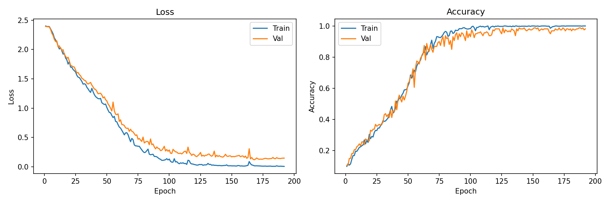

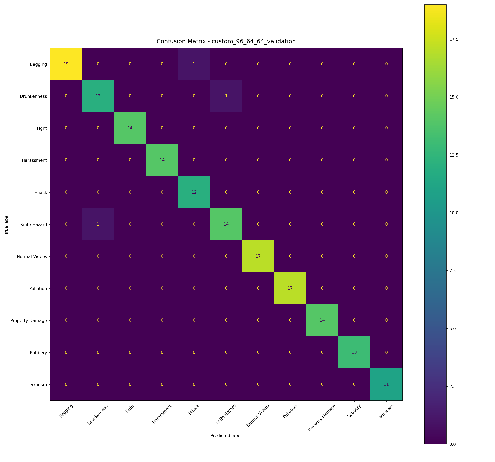

Original summary (local run archive): `runs/experiments/20261014_055751_451653_abnormal-activities-dataset_capacity/summary.json`

Run 02/64: 32-64-64 | 557,771 parameters | validation 97.500%

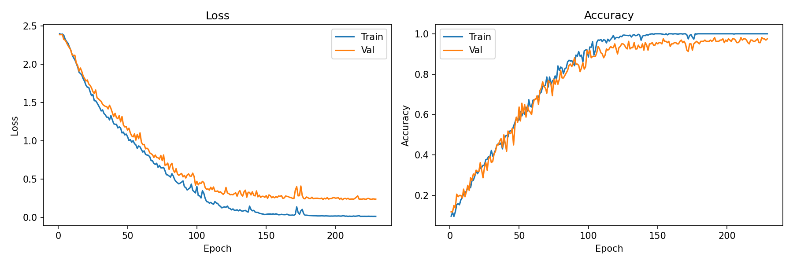

Original summary (local run archive): `runs/experiments/20261014_060241_793211_abnormal-activities-dataset_capacity/summary.json`

Run 03/64: 64-96-64 | 1,077,579 parameters | validation 98.750%

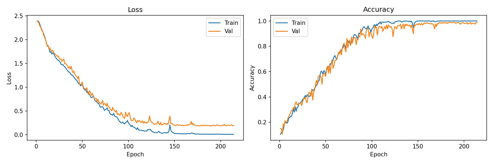

Original summary (local run archive): `runs/experiments/20261014_060617_509209_abnormal-activities-dataset_capacity/summary.json`

Run 04/64: 48-48-48 | 421,019 parameters | validation 97.500%

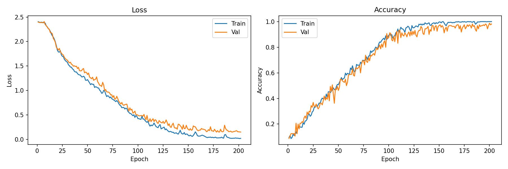

Original summary (local run archive): `runs/experiments/20261014_061051_182083_abnormal-activities-dataset_capacity/summary.json`

Run 05/64: 64-128-64 | 1,483,211 parameters | validation 98.125%

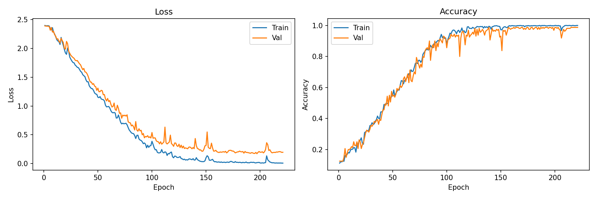

Original summary (local run archive): `runs/experiments/20261014_061353_515841_abnormal-activities-dataset_capacity/summary.json`

Run 06/64: 64-64-128 | 1,336,459 parameters | validation 98.125%

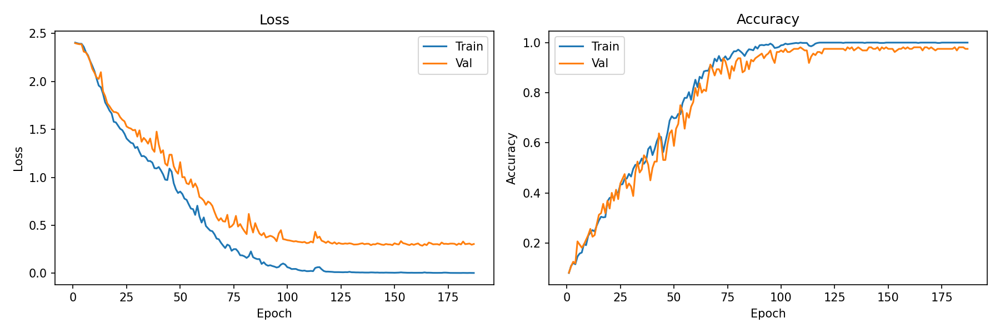

Original summary (local run archive): `runs/experiments/20261014_061916_386979_abnormal-activities-dataset_capacity/summary.json`

Run 07/64: 128-64-64 | 1,342,667 parameters | validation 98.125%

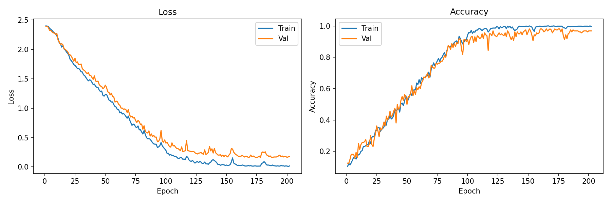

Original summary (local run archive): `runs/experiments/20261014_062330_074074_abnormal-activities-dataset_capacity/summary.json`

Run 08/64: 64-64-32 | 560,875 parameters | validation 98.750%

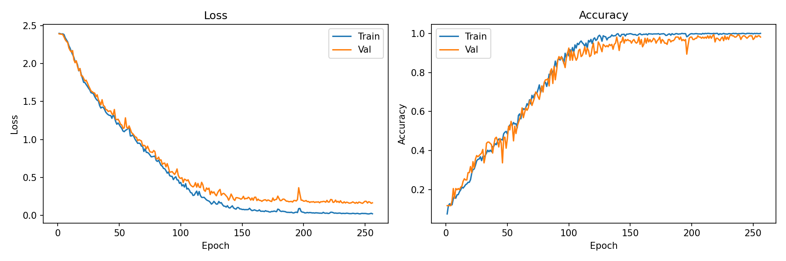

Original summary (local run archive): `runs/experiments/20261014_062829_824838_abnormal-activities-dataset_capacity/summary.json`

Run 09/64: 64-64-64-64-64 | 1,336,011 parameters | validation 97.500%

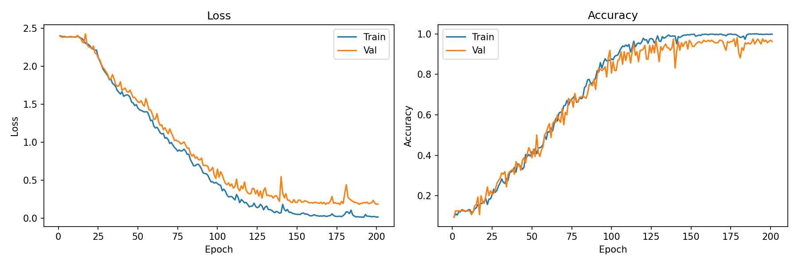

Original summary (local run archive): `runs/experiments/20261014_063234_009399_abnormal-activities-dataset_capacity/summary.json`

Run 10/64: 96-96-96 | 1,671,467 parameters | validation 97.500%

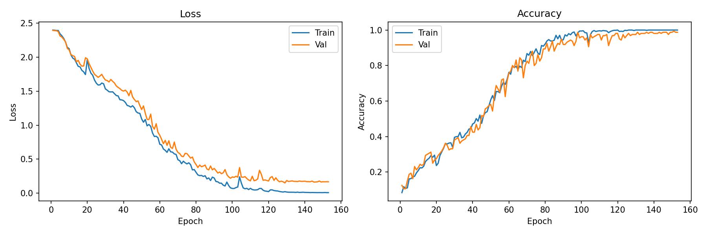

Original summary (local run archive): `runs/experiments/20261014_063756_532951_abnormal-activities-dataset_capacity/summary.json`

Run 11/64: 16-16-16 | 48,187 parameters | validation 81.875%

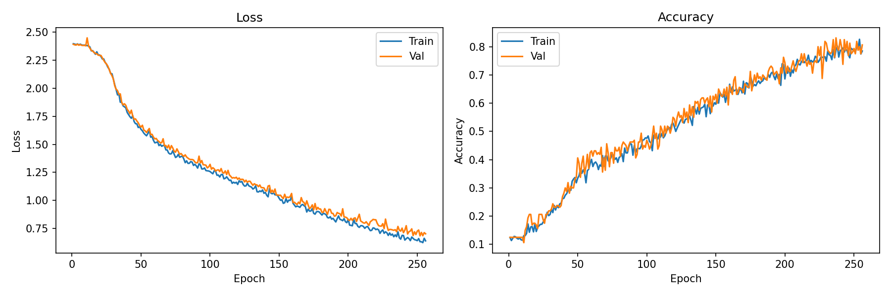

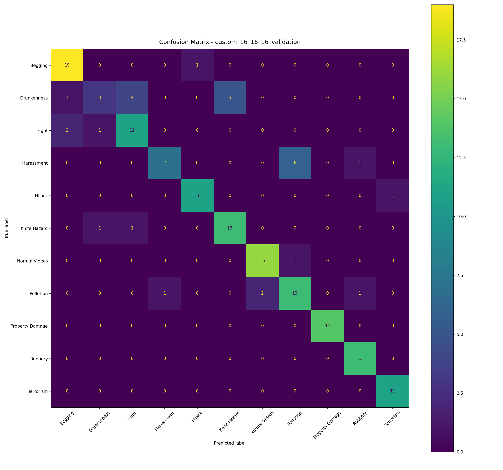

Original summary (local run archive): `runs/experiments/20261014_064208_296286_abnormal-activities-dataset_capacity/summary.json`

Run 12/64: 64 | 155,339 parameters | validation 95.625%

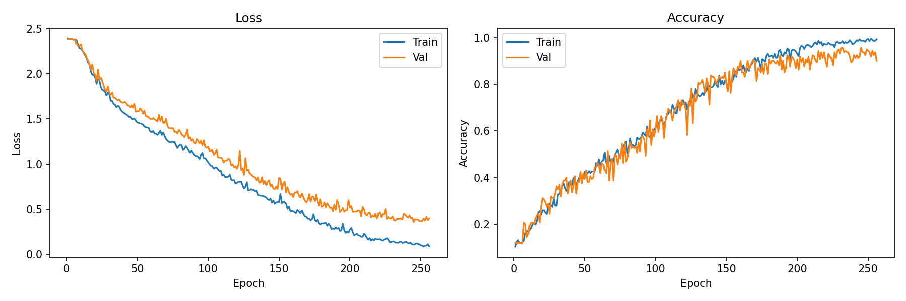

Original summary (local run archive): `runs/experiments/20261014_064528_607861_abnormal-activities-dataset_capacity/summary.json`

Run 13/64: 64-64 | 450,507 parameters | validation 98.750%

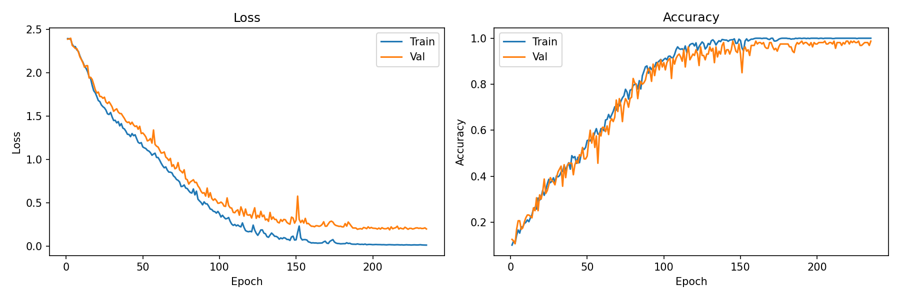

Original summary (local run archive): `runs/experiments/20261014_064733_437702_abnormal-activities-dataset_capacity/summary.json`

Run 14/64: 64-64-64 | 745,675 parameters | validation 96.875%

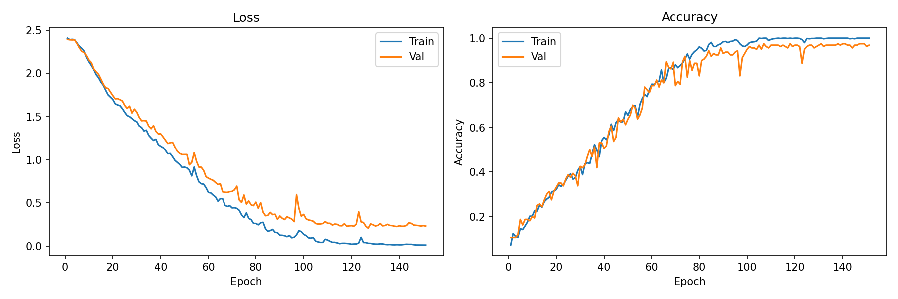

Original summary (local run archive): `runs/experiments/20261014_065038_504344_abnormal-activities-dataset_capacity/summary.json`

Run 15/64: 64-64-64-64 | 1,040,843 parameters | validation 95.000%

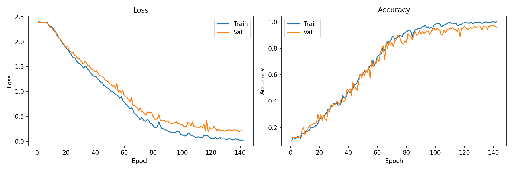

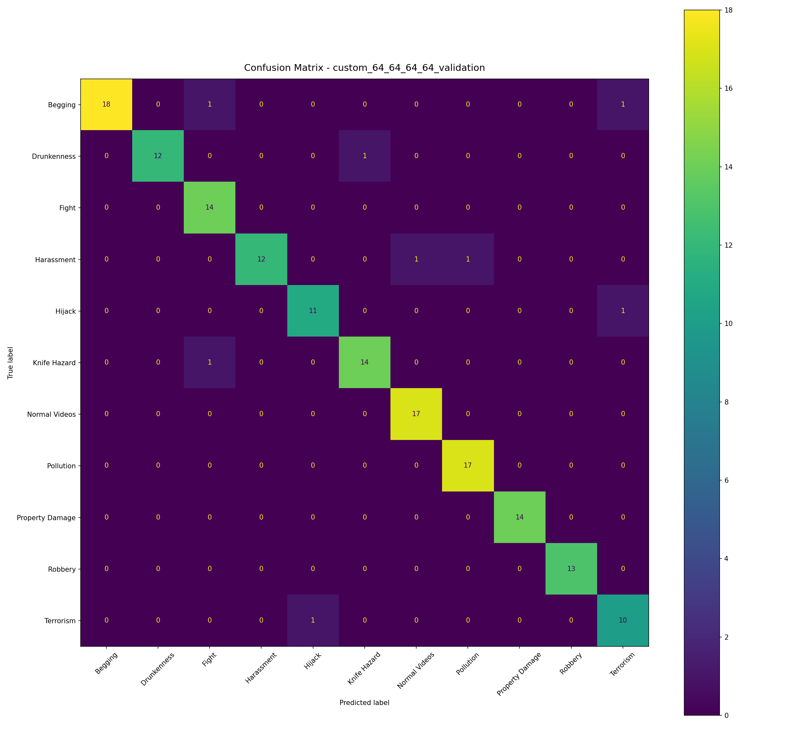

Original summary (local run archive): `runs/experiments/20261014_065316_028078_abnormal-activities-dataset_capacity/summary.json`

Run 16/64: 128-128-128 | 2,965,899 parameters | validation 96.875%

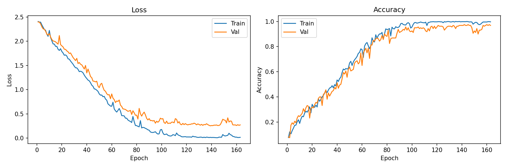

Original summary (local run archive): `runs/experiments/20261014_065626_018278_abnormal-activities-dataset_capacity/summary.json`

## 32px / 16 FPS (16 runs)

Run 17/64: 96-64-64 | 1,007,307 parameters | validation 97.500%

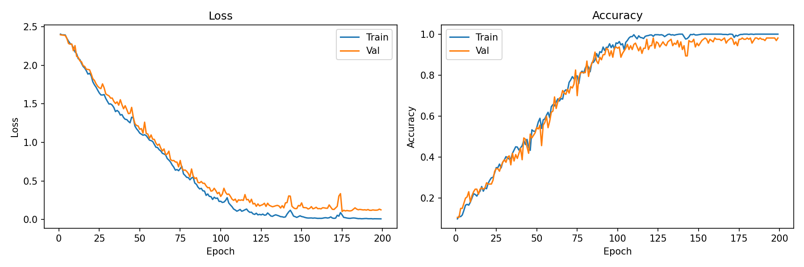

Original summary (local run archive): `runs/experiments/20261014_070235_261401_abnormal-activities-dataset_capacity/summary.json`

Run 18/64: 32-64-64 | 557,771 parameters | validation 98.750%

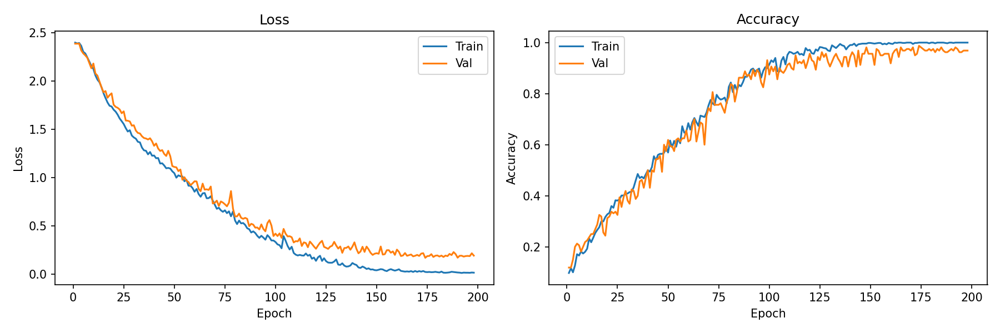

Original summary (local run archive): `runs/experiments/20261014_070703_417459_abnormal-activities-dataset_capacity/summary.json`

Run 19/64: 64-96-64 | 1,077,579 parameters | validation 98.750%

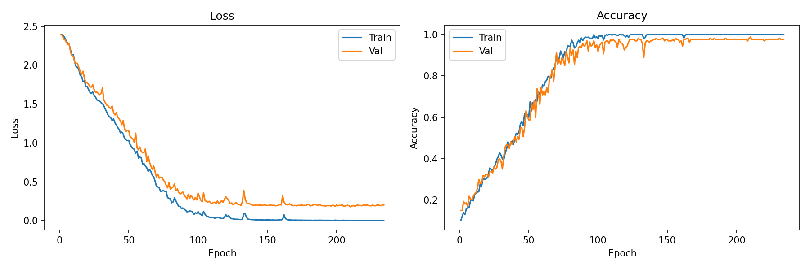

Original summary (local run archive): `runs/experiments/20261014_071017_545655_abnormal-activities-dataset_capacity/summary.json`

Run 20/64: 48-48-48 | 421,019 parameters | validation 98.750%

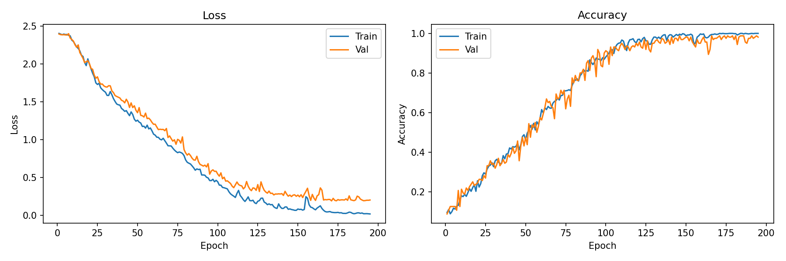

Original summary (local run archive): `runs/experiments/20261014_071522_433074_abnormal-activities-dataset_capacity/summary.json`

Run 21/64: 64-128-64 | 1,483,211 parameters | validation 97.500%

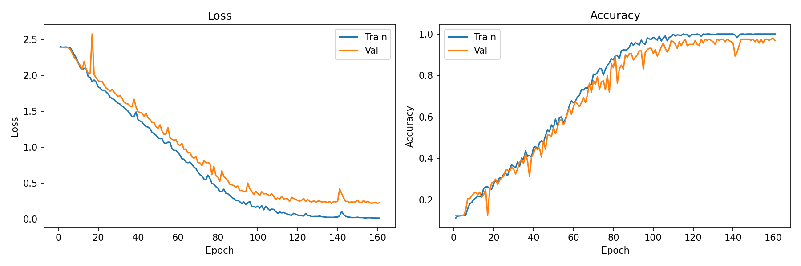

Original summary (local run archive): `runs/experiments/20261014_071822_273329_abnormal-activities-dataset_capacity/summary.json`

Run 22/64: 64-64-128 | 1,336,459 parameters | validation 98.125%

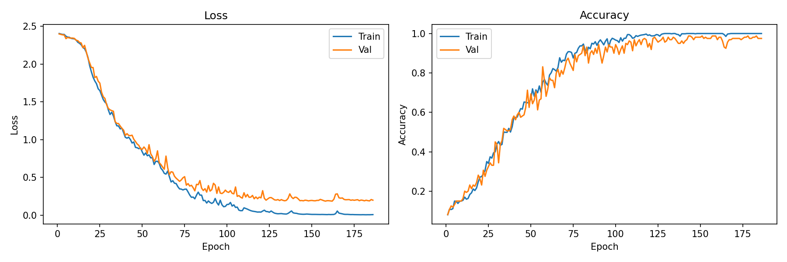

Original summary (local run archive): `runs/experiments/20261014_072222_620262_abnormal-activities-dataset_capacity/summary.json`

Run 23/64: 128-64-64 | 1,342,667 parameters | validation 98.125%

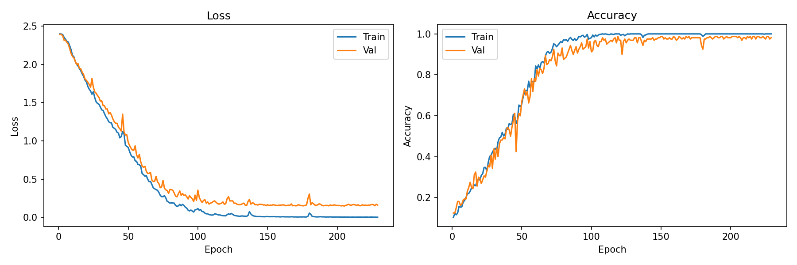

Original summary (local run archive): `runs/experiments/20261014_072640_473860_abnormal-activities-dataset_capacity/summary.json`

Run 24/64: 64-64-32 | 560,875 parameters | validation 98.125%

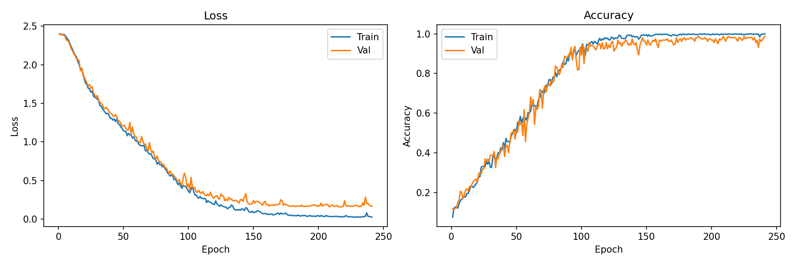

Original summary (local run archive): `runs/experiments/20261014_073225_570446_abnormal-activities-dataset_capacity/summary.json`

Run 25/64: 64-64-64-64-64 | 1,336,011 parameters | validation 98.125%

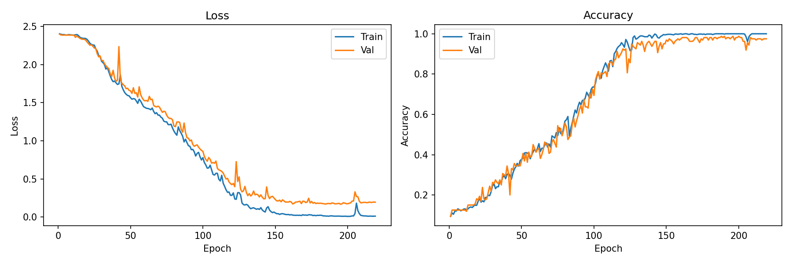

Original summary (local run archive): `runs/experiments/20261014_073619_915865_abnormal-activities-dataset_capacity/summary.json`

Run 26/64: 96-96-96 | 1,671,467 parameters | validation 98.125%

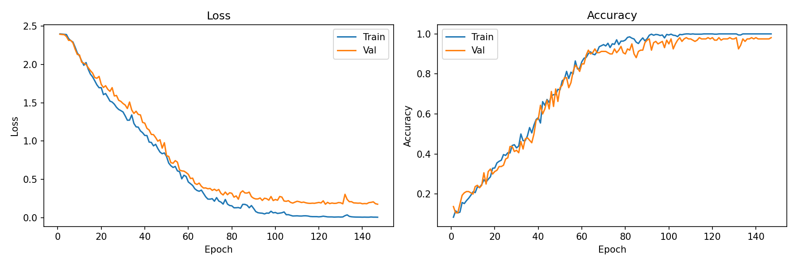

Original summary (local run archive): `runs/experiments/20261014_074216_098189_abnormal-activities-dataset_capacity/summary.json`

Run 27/64: 16-16-16 | 48,187 parameters | validation 82.500%

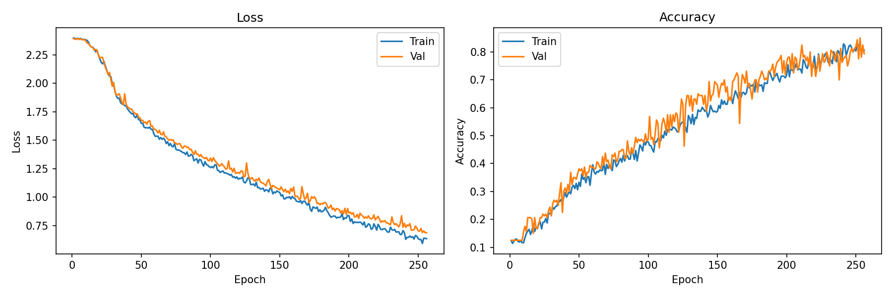

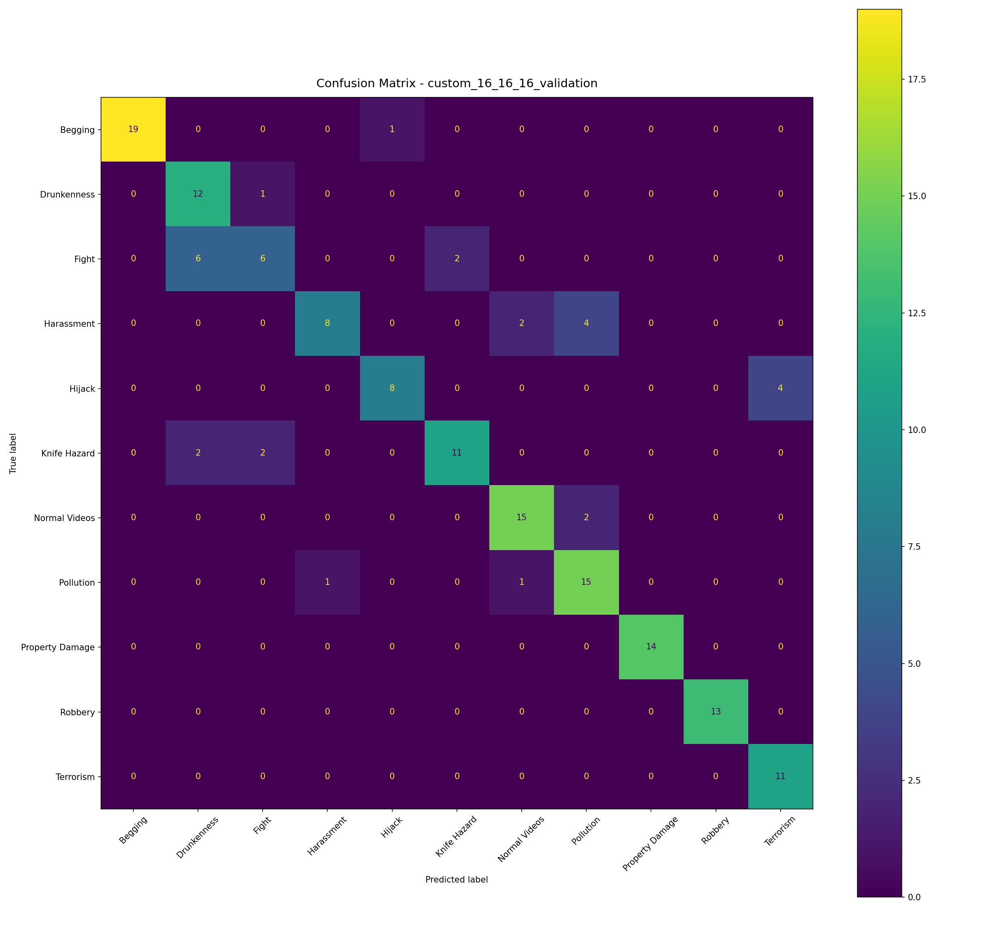

Original summary (local run archive): `runs/experiments/20261014_074621_804056_abnormal-activities-dataset_capacity/summary.json`

Run 28/64: 64 | 155,339 parameters | validation 97.500%

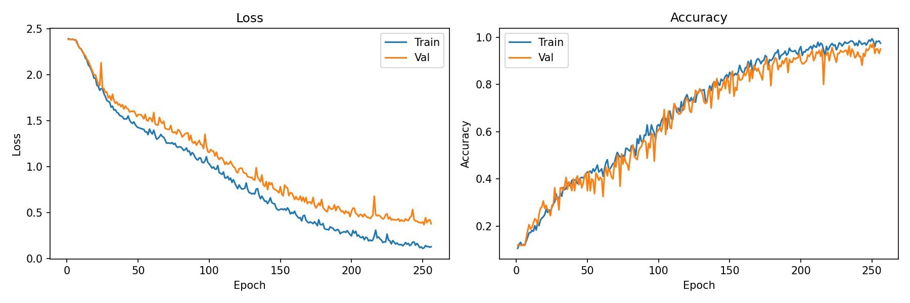

Original summary (local run archive): `runs/experiments/20261014_074944_761690_abnormal-activities-dataset_capacity/summary.json`

Run 29/64: 64-64 | 450,507 parameters | validation 97.500%

Original summary (local run archive): `runs/experiments/20261014_075153_343419_abnormal-activities-dataset_capacity/summary.json`

Run 30/64: 64-64-64 | 745,675 parameters | validation 97.500%

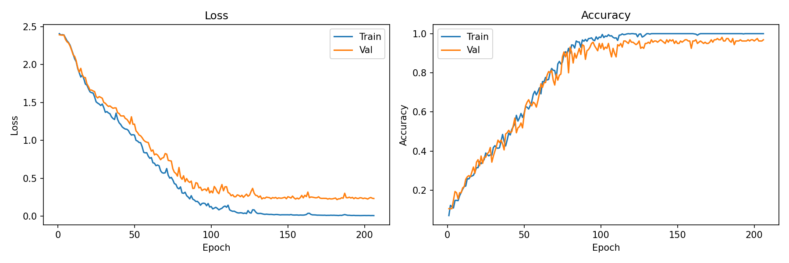

Original summary (local run archive): `runs/experiments/20261014_075442_137265_abnormal-activities-dataset_capacity/summary.json`

Run 31/64: 64-64-64-64 | 1,040,843 parameters | validation 97.500%

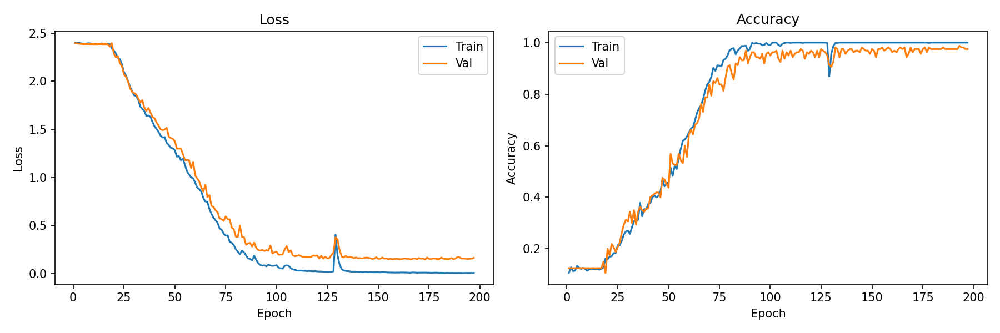

Original summary (local run archive): `runs/experiments/20261014_075819_015684_abnormal-activities-dataset_capacity/summary.json`

Run 32/64: 128-128-128 | 2,965,899 parameters | validation 96.875%

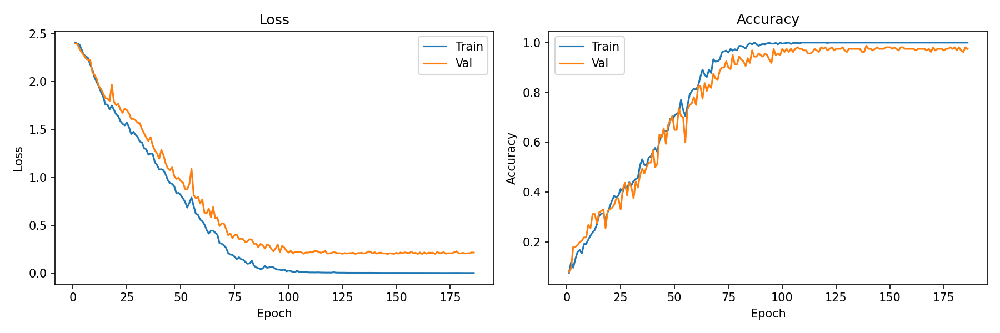

Original summary (local run archive): `runs/experiments/20261014_080243_030159_abnormal-activities-dataset_capacity/summary.json`

## 64px / 8 FPS (16 runs)

Run 33/64: 96-64-64 | 1,007,307 parameters | validation 96.875%

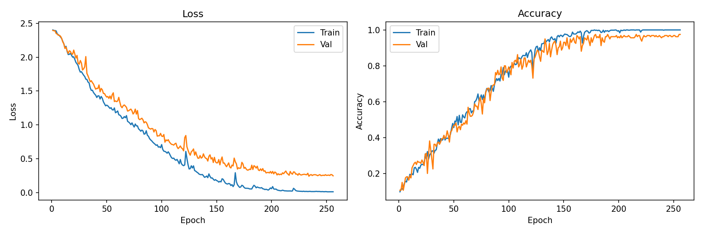

Original summary (local run archive): `runs/experiments/20261014_080946_312637_abnormal-activities-dataset_capacity/summary.json`

Run 34/64: 32-64-64 | 557,771 parameters | validation 96.250%

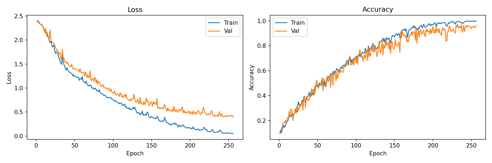

Original summary (local run archive): `runs/experiments/20261014_082730_097704_abnormal-activities-dataset_capacity/summary.json`

Run 35/64: 64-96-64 | 1,077,579 parameters | validation 96.875%

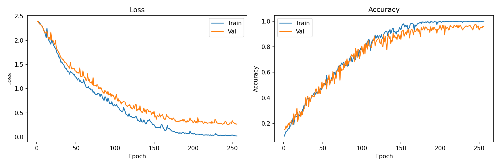

Original summary (local run archive): `runs/experiments/20261014_083845_154993_abnormal-activities-dataset_capacity/summary.json`

Run 36/64: 48-48-48 | 421,019 parameters | validation 96.875%

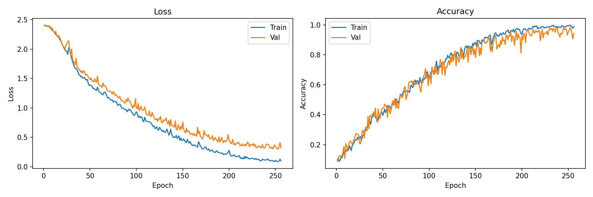

Original summary (local run archive): `runs/experiments/20261014_085625_458328_abnormal-activities-dataset_capacity/summary.json`

Run 37/64: 64-128-64 | 1,483,211 parameters | validation 98.125%

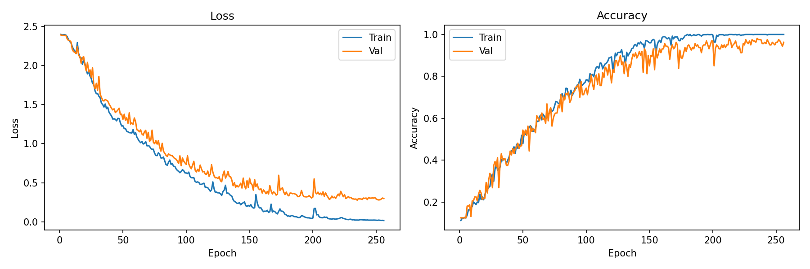

Original summary (local run archive): `runs/experiments/20261014_090643_151541_abnormal-activities-dataset_capacity/summary.json`

Run 38/64: 64-64-128 | 1,336,459 parameters | validation 97.500%

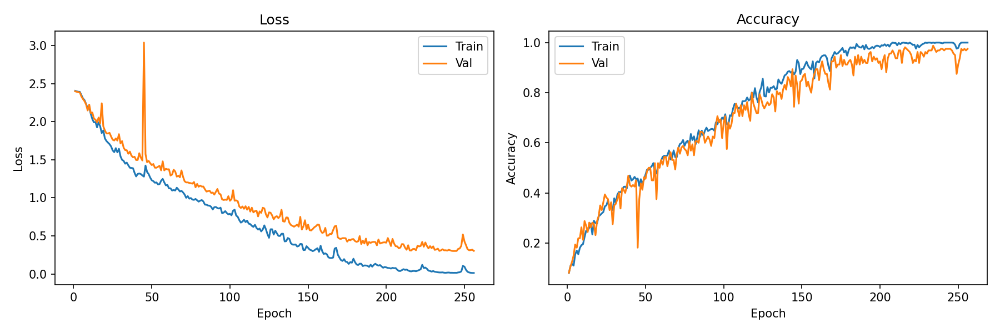

Original summary (local run archive): `runs/experiments/20261014_092713_076747_abnormal-activities-dataset_capacity/summary.json`

Run 39/64: 128-64-64 | 1,342,667 parameters | validation 98.125%

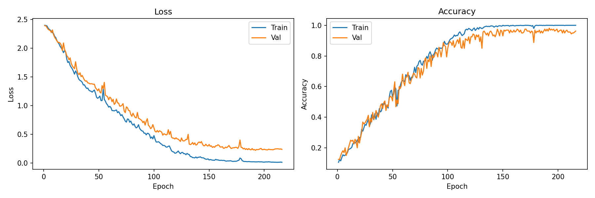

Original summary (local run archive): `runs/experiments/20261014_094604_454828_abnormal-activities-dataset_capacity/summary.json`

Run 40/64: 64-64-32 | 560,875 parameters | validation 96.250%

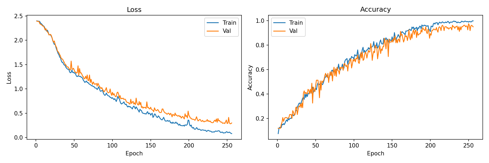

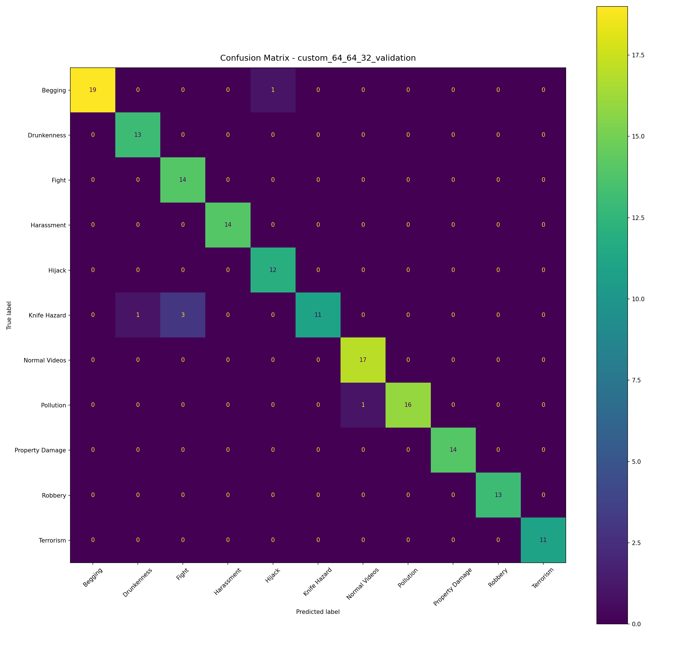

Original summary (local run archive): `runs/experiments/20261014_100351_897850_abnormal-activities-dataset_capacity/summary.json`

Run 41/64: 64-64-64-64-64 | 1,336,011 parameters | validation 98.125%

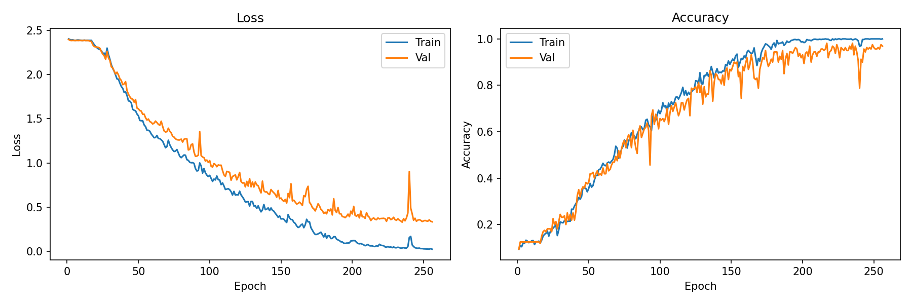

Original summary (local run archive): `runs/experiments/20261014_101521_945959_abnormal-activities-dataset_capacity/summary.json`

Run 42/64: 96-96-96 | 1,671,467 parameters | validation 97.500%

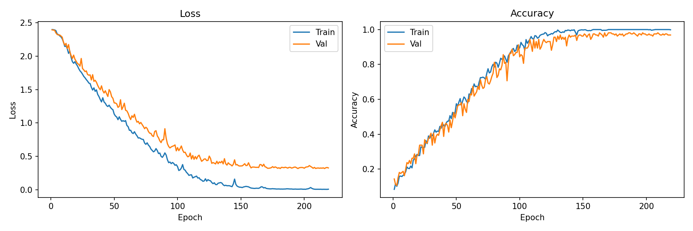

Original summary (local run archive): `runs/experiments/20261014_103731_393506_abnormal-activities-dataset_capacity/summary.json`

Run 43/64: 16-16-16 | 48,187 parameters | validation 58.125%

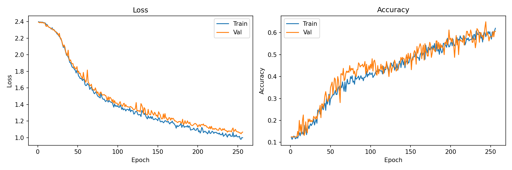

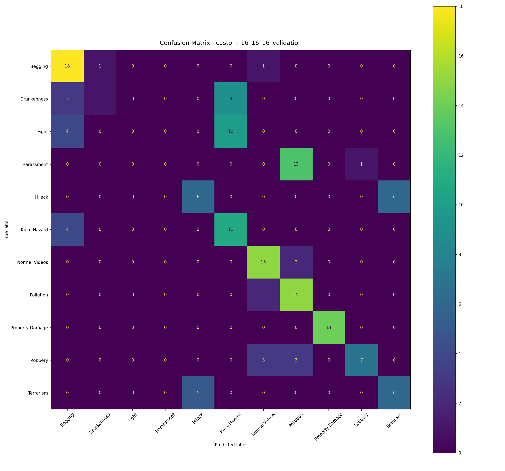

Original summary (local run archive): `runs/experiments/20261014_105853_589318_abnormal-activities-dataset_capacity/summary.json`

Run 44/64: 64 | 155,339 parameters | validation 81.250%

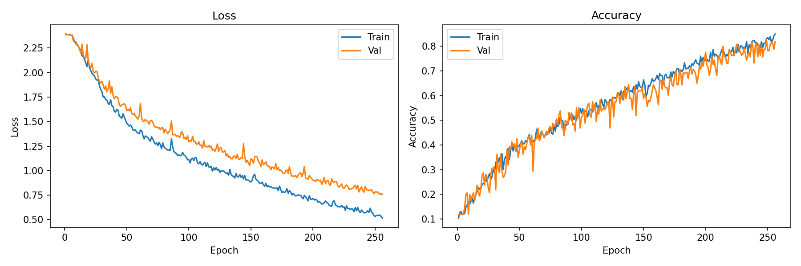

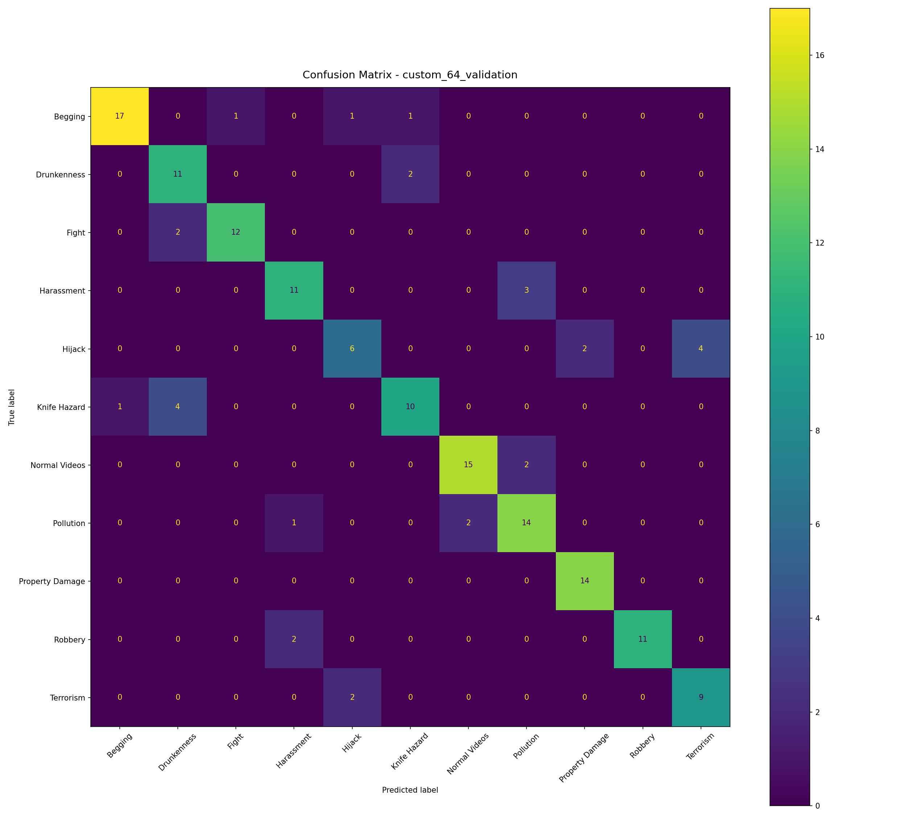

Original summary (local run archive): `runs/experiments/20261014_110439_805298_abnormal-activities-dataset_capacity/summary.json`

Run 45/64: 64-64 | 450,507 parameters | validation 97.500%

Original summary (local run archive): `runs/experiments/20261014_110913_835904_abnormal-activities-dataset_capacity/summary.json`

Run 46/64: 64-64-64 | 745,675 parameters | validation 98.125%

Original summary (local run archive): `runs/experiments/20261014_111810_906066_abnormal-activities-dataset_capacity/summary.json`

Run 47/64: 64-64-64-64 | 1,040,843 parameters | validation 97.500%

Original summary (local run archive): `runs/experiments/20261014_113006_947748_abnormal-activities-dataset_capacity/summary.json`

Run 48/64: 128-128-128 | 2,965,899 parameters | validation 96.875%

Original summary (local run archive): `runs/experiments/20261014_114752_445530_abnormal-activities-dataset_capacity/summary.json`

## 64px / 16 FPS (16 runs)

Run 49/64: 96-64-64 | 1,007,307 parameters | validation 99.375%

Original summary (local run archive): `runs/experiments/20261014_121953_868509_abnormal-activities-dataset_capacity/summary.json`

Run 50/64: 32-64-64 | 557,771 parameters | validation 96.875%

Original summary (local run archive): `runs/experiments/20261014_123737_375358_abnormal-activities-dataset_capacity/summary.json`

Run 51/64: 64-96-64 | 1,077,579 parameters | validation 98.750%

Original summary (local run archive): `runs/experiments/20261014_124854_064371_abnormal-activities-dataset_capacity/summary.json`

Run 52/64: 48-48-48 | 421,019 parameters | validation 98.125%

Original summary (local run archive): `runs/experiments/20261014_130635_679336_abnormal-activities-dataset_capacity/summary.json`

Run 53/64: 64-128-64 | 1,483,211 parameters | validation 98.750%

Original summary (local run archive): `runs/experiments/20261014_131655_581562_abnormal-activities-dataset_capacity/summary.json`

Run 54/64: 64-64-128 | 1,336,459 parameters | validation 98.750%

Original summary (local run archive): `runs/experiments/20261014_133510_376052_abnormal-activities-dataset_capacity/summary.json`

Run 55/64: 128-64-64 | 1,342,667 parameters | validation 98.125%

Original summary (local run archive): `runs/experiments/20261014_134940_631917_abnormal-activities-dataset_capacity/summary.json`

Run 56/64: 64-64-32 | 560,875 parameters | validation 97.500%

Original summary (local run archive): `runs/experiments/20261014_141050_381383_abnormal-activities-dataset_capacity/summary.json`

Run 57/64: 64-64-64-64-64 | 1,336,011 parameters | validation 12.500%

Original summary (local run archive): `runs/experiments/20261014_142223_730925_abnormal-activities-dataset_capacity/summary.json`

Run 58/64: 96-96-96 | 1,671,467 parameters | validation 95.625%

Original summary (local run archive): `runs/experiments/20261014_142851_193684_abnormal-activities-dataset_capacity/summary.json`

Run 59/64: 16-16-16 | 48,187 parameters | validation 70.625%

Original summary (local run archive): `runs/experiments/20261014_145235_077839_abnormal-activities-dataset_capacity/summary.json`

Run 60/64: 64 | 155,339 parameters | validation 81.875%

Original summary (local run archive): `runs/experiments/20261014_145824_548738_abnormal-activities-dataset_capacity/summary.json`

Run 61/64: 64-64 | 450,507 parameters | validation 96.250%

Original summary (local run archive): `runs/experiments/20261014_150302_701456_abnormal-activities-dataset_capacity/summary.json`

Run 62/64: 64-64-64 | 745,675 parameters | validation 98.125%

Original summary (local run archive): `runs/experiments/20261014_151202_248040_abnormal-activities-dataset_capacity/summary.json`

Run 63/64: 64-64-64-64 | 1,040,843 parameters | validation 95.625%

Original summary (local run archive): `runs/experiments/20261014_152525_422774_abnormal-activities-dataset_capacity/summary.json`

Run 64/64: 128-128-128 | 2,965,899 parameters | validation 97.500%

Original summary (local run archive): `runs/experiments/20261014_154314_055448_abnormal-activities-dataset_capacity/summary.json`

