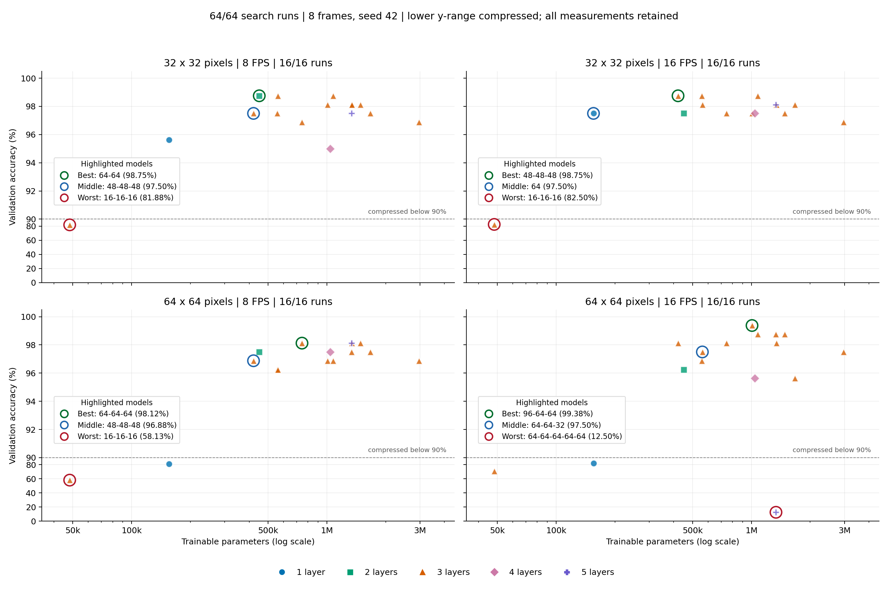

# AAD search: all 64 configurations

Review: 15 October 2026. Search executed 14 October 2026 (timezone unverified).
Reformatted from the unchanged [original review](../2026-10-14/README.md).
**Validation-only, single-seed results. No training or test evaluation was run.**

16 architectures x two resolutions x two sampling rates = **64 configurations**, not 64 architectures.
Each panel plots all 16 measured models; the failed-learning result is retained.



[Vector figure](search_capacity.svg). The bottom legend shows only the five original layer-count colours/shapes.
Each panel's small legend names the highlighted models in order: Best, Middle, Worst, with accuracy to two decimals.
No arrows, inset zooms or performance tables.

## Reading the graphs

Coloured rings highlight the Best, Middle and Worst **observed model within each panel**.
This keeps different FPS/resolution conditions separate. Ties choose fewer parameters, then run ID;
these illustrative highlights do not change the across-condition ranking or claim a global optimum.
Middle means the actual model closest to that panel's median accuracy, not a fabricated average point.

Every marker keeps its measured coordinates; all 64 unique observations remain, including the 12.5% failure.
The **y-axis is not uniformly spaced**: below 90%, a percentage point uses one twentieth of the
vertical distance used above 90%. The dashed 90% line marks the transition; tick labels show true accuracy.
This stretches the high-score region without dropping low values or adding extra zoom plots.
The same scale is used in all four panels; nearby models can still overlap. Rings repeat selected
markers as highlights, not new data. Raw scores and the original uniformly scaled figure remain in the prior review.

## Evidence and limits

The saved CSV/portable JSON reconcile with the raw console and archived finalist configuration.
All 128 report image copies match the hashes in the earlier verification receipt.
Original run files available/hash-checked here: 0; unavailable: 258.
The earlier summary/history/selection audit remains historical: this rebuild does not claim
fresh verification of missing originals, checkpoints, dataset membership or final test performance.
See [current verification](visibility_check.json) for source hashes and exact unavailable paths.

Nothing here requires repeating search just to display the results. Recover original evidence
for a full provenance audit; transformer learning and final testing remain separate tasks.
One seed/input-condition sweep does not establish a global optimum or independent generalisation.

## Fixed settings and unchanged shortlist

All runs use eight RGB frames, seed 42, Adam LR 0.001, WD 0 and no augmentation.
AAD has 748 training / 160 validation / 161 locked test clips across 11 classes.
Search cap 256 epochs, minimum 64, patience 24; lowest validation-loss checkpoint.
Ranking uses equal-condition mean accuracy, worst-condition accuracy, loss, parameters and name.
The saved top five remain: [64-96-64], [128-64-64], [64-128-64], [64-64-128], [96-64-64].

[Unchanged full-precision CSV](../2026-10-14/search_results.csv) · [Unchanged architecture ranking](../2026-10-14/architecture_ranking.csv) · [All 128 original-image links](search_run_gallery.md)

## Next work

This is reporting, not a new result. Diagnose the collapsed transformers before final comparison.
The earlier ten comparison trainings finished, but test failed before scoring; no final test metrics are supplied here.
Use the complete evidence in [080: manuscript figure/appendix](../../../../../agents/work/080-aad-search-figure-and-appendix/prompt.md) after approval; the manuscript is unchanged.

## Rebuild

From the implementation directory (Python + matplotlib only):

```bash
.venv/bin/python reports/2026-10-14/build_preview.py --search-visibility --output-dir reports/2026-10-15
```

Rebuilding verifies source hashes and refuses to overwrite unrelated or edited output files.
