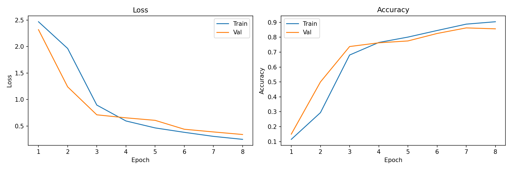
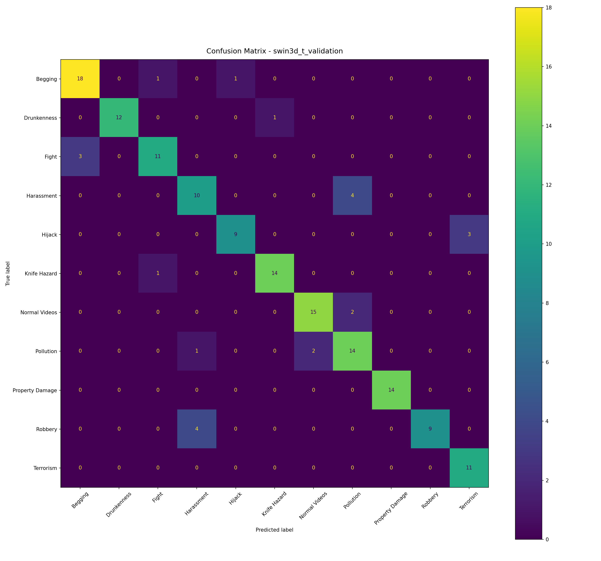

# Lower-LR Swin3D-T follow-up

15 October 2026. A separate owner-requested diagnostic, not a replacement for
the preserved shared-recipe comparison. The original diagnosis and scores remain
unchanged; no test data is used here.

## Why another run

The first eight-epoch local smoke run at LR 0.0001 selected epoch 8:
25/160 validation clips correct (15.625%), loss 2.362184. Its predictions were
150 Begging and ten Normal Videos. Final online training accuracy was 10.695%.
This was still poor discrimination, not evidence of ordinary overfitting.
Removing macro columns alone would not improve those predictions.

## Training-only checks

[Recorded traces](lower-lr-check.json) · [runtime manifest](lower-lr-run.json).
Both controls use the same four original training clips, seed 42, scratch
Swin3D-T, 11-class head, batch 2, eight 64px frames/16 FPS, Adam, WD 0,
no augmentation and exactly 128 updates. Only LR differs between the controls.

| LR | First recorded 100% training-subset accuracy | Loss at step 128 |
|---|---:|---:|
| 0.0001 | Step 56 | 0.000109 |
| 0.00001 | Step 24 | 0.000757 |

All recorded gradients were present/finite and the representative parameters
updated. The smaller rate reached perfect classification of these four clips
earlier; the larger rate had lower loss at step 128. These are memorization
checks, not validation scores, independent seeds or proof of the best LR.
They demonstrate that Swin3D-T can discriminate these clips through the shared
model/training path. The earlier 64-step check at LR 0.001 remained a failure;
its smaller budget differs and it is not silently relabelled as a matched trial.

## Eight-epoch validation check

The smoke JSON now uses LR **0.00001**. Model, input, dataset/split, seed,
batch 2, optimizer, WD, augmentation, scheduler and eight-epoch cap are otherwise
unchanged from the preceding full-dataset local smoke run. Checkpoint selection
remains minimum validation loss, not maximum reported accuracy.

Run directory: `runs/experiments/20261015_121227_369614_abnormal-activities-dataset_baseline-comparison/`.
The run completed. See its `models/swin3d_t/metrics/` for history, metrics,
confusion and curves, and `predictions/` for three correct and three incorrect
validation videos. Portable copies: [metrics](lower-lr-validation.json),
[history](lower-lr-history.json), and figures below. No test score is implied.

| LR | Selected epoch | Online train accuracy % | Validation correct / 160 | Validation accuracy % | Validation loss |
|---|---:|---:|---:|---:|---:|
| 0.0001, preceding run | 8 | 10.695 | 25 | 15.625 | 2.362184 |
| 0.00001, new run | 8 | 90.374 | 137 | 85.625 | 0.340819 |

Both resolved configurations are identical except LR and reference the exact
same split hash. At the new selected checkpoint, all 11 classes are predicted;
the old run predicted only two. Epoch 7 had slightly higher validation accuracy
(86.250%) but epoch 8 had lower loss, so epoch 8 remains selected. No checkpoint
was switched just to report the largest accuracy.

Lower LR restored useful learning in this controlled, single-seed Swin3D-T
diagnostic. It does not prove the globally best LR, robustness across seeds,
test generalization or that every transformer is repaired. The shared
production model/optimizer/loss were unchanged; increasing epochs alone was
not the remedy tested. The measured training loop took 331 seconds, excluding
cache preparation/final artifact passes; this is not an A100 runtime estimate.

## Metrics output

New direct modular experiment runs retain loss, accuracy and pooled
precision/recall/F1, full per-class records and confusion matrices. They no
longer calculate or add macro/balanced averages to the JSON, CSV, Markdown or
console. Pooled precision/recall/F1 equal accuracy for this single-label task.
Archived results and explicitly invoked legacy campaigns keep their historical
metric contracts; no old score is rewritten or relabelled.

The change is confined to this diagnostic path, not an unapproved new paper
comparison protocol. Swin3D-S recovery and a longer/final ten-model comparison
still need their own verification/approval through ticket 083. No pretraining,
normalization, architecture or input change was introduced.

Verification: 84 focused configuration/diagnostic/metric/protocol tests passed;
all 33 capacity-search tests also passed, including pooled-only output and
legacy compatibility. Actual new summary/results JSON, CSV and Markdown contain
no macro/balanced keys or columns; pooled P/R/F1 agree with 137/160 accuracy.
Original runs and source-report evidence remain unchanged. No commit or push.
