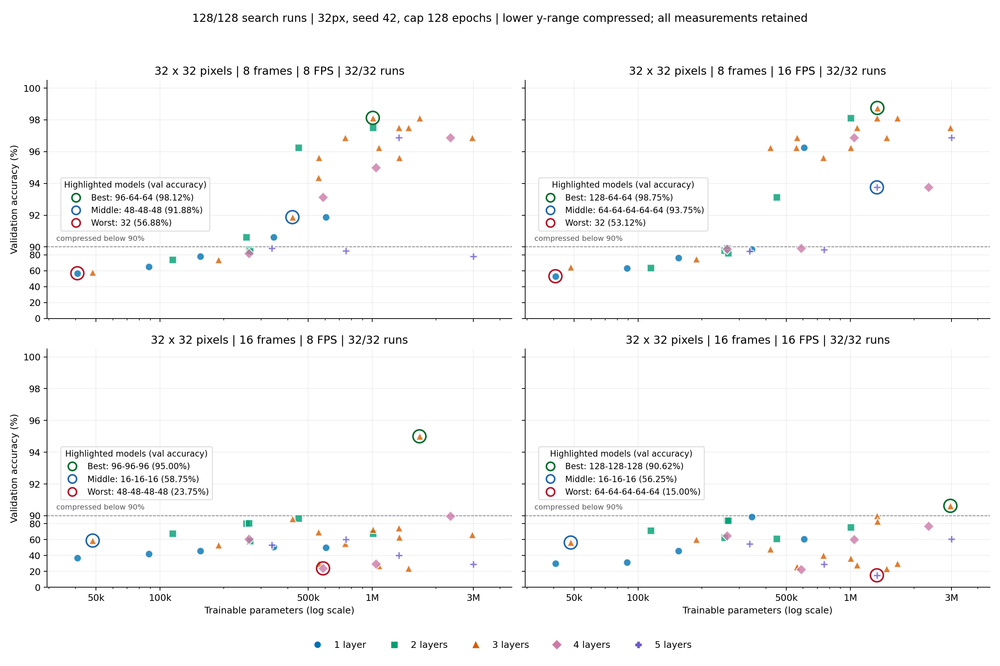
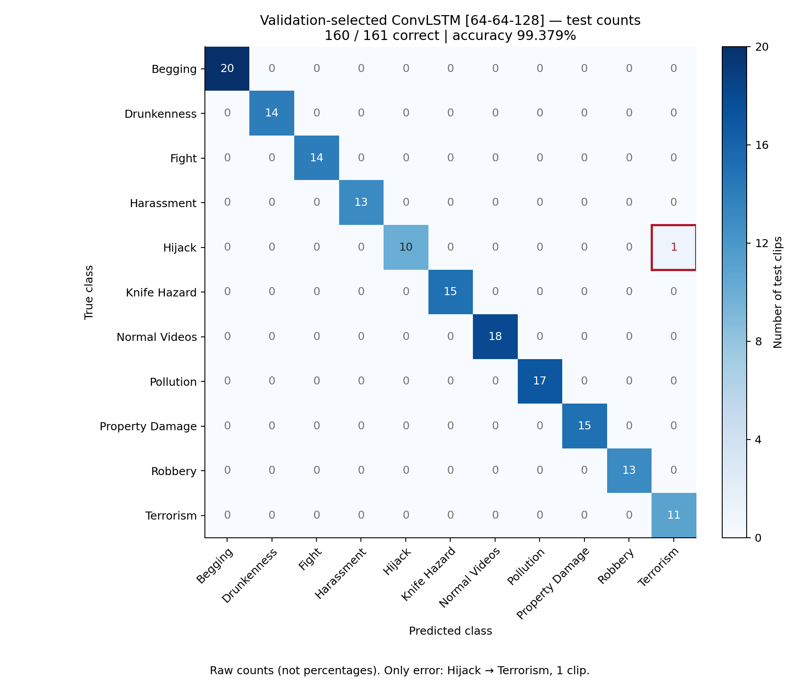

# AAD campaign preview — 16 October 2026

## 1. What finished and what was verified

- **Best validation-selected custom: `[64,64,128]`; test 160/161 correct
  (99.379%), with 1,336,459 parameters.** This is a strong result on this split,
  not proof of a globally optimal architecture or deployment reliability.
- Execution: 15–16 October 2026 UTC; review: 16 October, Johannesburg.
  A100-SXM4 **80 GB**, PyTorch 2.9.1+cu128, revision `c8786d1`.
  Summed training time: **6.90 h search + 0.96 h checks + 2.25 h comparison**;
  approximately 10.12 h, excluding setup, probes and evaluation overhead.
- AAD: 11 classes, 1,069 clips; fixed stratified **748 train / 160 validation /
  161 test**, seed 42. Splitting is clip-level, not verified actor/scene-level.
- The supplied **4.19 MB results ZIP matches the final logged Drive-copy hash**.
  All 128 search jobs, five resolution checks and ten comparisons are present;
  experiment numbers run continuously from 1 to 143. Recomputed metrics from
  **131,454 prediction records** agree with saved confusion/per-class counts.
  See [verification](verification.json) and [evidence/preservation notes](evidence/README.md).
  This checks archive consistency, not a fresh model run or live Drive access.

## 2. Architecture search: setup → graph → findings

- **32 architectures × 8/16 frames × 8/16 FPS = 128 trainings**, all at 32×32.
  Depths 1–5; flat and shaped stacks, widths 16–128. Adam, initial LR 0.001,
  weight decay 0, no augmentation, batch 32; cap 128 epochs, minimum 64,
  patience 24. Checkpoints use lowest validation loss; test remains locked.
- Rank architectures by mean validation accuracy across the four temporal
  conditions, then worst-condition accuracy, loss and size. This averages
  **experimental conditions, not class metrics**. It is not a multi-seed estimate.
  All runs appear below. As in the [October 15 figure](../2026-10-15/README.md),
  each panel names its **Best / Middle / Worst** observed model and validation
  accuracy; green/blue/red rings mark those points. Layer colours/shapes are unchanged.

- **Scale:** parameters use a log axis. Below 90% accuracy, vertical distances
  are compressed **20×**; above 90% they are expanded relative to that lower
  range. The dashed line marks the transition; ticks show actual percentages.
  All four panels share this scale; no observations are dropped or moved.
  [Linear-scale alternative](search_capacity_linear.png) · [Vector figure](search_capacity.svg).
- Best/Worst use each panel's validation accuracy; Middle is the actual model
  nearest its median. Ties favour fewer parameters, then experiment number.
  These illustrative highlights **do not replace the across-condition shortlist**.
  [Plot verification and exact highlight values](presentation_check.json).

- **Top five**, in saved search order (four-condition mean validation accuracy):
  `[64,64,128]` **90.000%**; `[96,96,96,96]` **89.219%**;
  `[128,128,128]` **87.813%**; `[128,64,64]` **85.156%**;
  `[32,64]` **84.844%**. The best *individual* run was `[128,64,64]`
  at 98.750%; selecting that row alone would ignore temporal sensitivity.
- **There is no universal turning point.** Width-96 flat stacks peak locally
  at four layers (89.219% mean), then fall at five (66.094%). But the widest
  three-layer flat stack tested, `[128,128,128]`, remains best within that
  width sweep. See the [matched depth/width plots](capacity_controls.png),
  [full ranking](architecture_ranking.csv) and [all 128 rows](search_results.csv).
- **Longer clips expose a limitation:** mean validation accuracy falls from
  88.03/88.18% at eight frames to 57.03/53.57% at sixteen frames (8/16 FPS).
  Matched training means also fall, from about 92% to 61/57%: this is not clean
  evidence that large models overfit. Optimization, temporal content and the
  budget may matter; 108/128 jobs hit the epoch cap. Full curves are absent.
- The finalists selected **eight frames at 16 FPS** (95.25% mean at 32px).
  Five fresh 64px checks gave **95.000, 93.125, 95.000, 90.000, 69.375%** in
  shortlist order; all five progressed. Only finalists were checked at 64px,
  so do not claim the entire architecture ranking transfers across resolutions.

## 3. Final comparison: setup → table → interpretation

- Ten fresh models, **eight 64×64 frames at 16 FPS**, same split/seed/batch;
  Adam and no augmentation/weight decay. Cap **256 epochs**, minimum 128,
  patience 32; actual stopping epochs vary. LR **0.001**, except Swin-T/S
  **0.00001**, approved after both passed training-only learning checks.
  No pretraining. Checkpoints use validation loss; the best custom is chosen
  by validation accuracy and frozen before test. The paper baseline is
  **input-adapted**, not an exact original-protocol reproduction.
- The table reports **test metrics only**, with separate columns for all four
  classification scores. **Accuracy = pooled precision = pooled recall = pooled
  F1**: each single-label error contributes one false positive and one false
  negative. Equality is expected, not a bug; these are **not macro averages**.
  [Per-class P/R/F1, support and counts](comparison_per_class.csv) and
  [all confusion matrices](test_confusion_matrices.json) retain class detail.
  [Download the test-only table](comparison_test.csv); parameters are model
  properties and latency is a separate efficiency benchmark, not a split score.
- Latency is FP32, batch-one **model-only** on A100: three warm-ups, ten timed
  forwards; excludes decoding/transfers. It is not end-to-end surveillance speed.

| Model / recurrent widths | Accuracy (%) | Precision (%) | Recall (%) | F1 (%) | Params (M) | Test loss | ms/clip |
|---|---:|---:|---:|---:|---:|---:|---:|
| **Custom 64–64–128** | **99.379** | **99.379** | **99.379** | **99.379** | **1.336** | **0.0403** | 6.12 |
| Custom 96–96–96–96 | 98.137 | 98.137 | 98.137 | 98.137 | 2.335 | 0.0798 | 8.12 |
| Custom 128–128–128 | 98.758 | 98.758 | 98.758 | 98.758 | 2.966 | 0.0513 | 6.23 |
| Custom 128–64–64 | 98.137 | 98.137 | 98.137 | 98.137 | 1.343 | 0.0938 | 6.11 |
| Custom 32–64 | 92.547 | 92.547 | 92.547 | 92.547 | 0.263 | 0.3068 | 4.37 |
| Paper ConvLSTM, input-adapted | 94.410 | 94.410 | 94.410 | 94.410 | 134.415 | 0.7242 | 3.46 |
| R3D-18 | 95.031 | 95.031 | 95.031 | 95.031 | 33.172 | 0.1661 | 3.72 |
| MC3-18 | 97.516 | 97.516 | 97.516 | 97.516 | 11.496 | 0.0695 | **3.30** |
| Swin3D-T | 93.168 | 93.168 | 93.168 | 93.168 | 27.859 | 0.1496 | 22.05 |
| Swin3D-S | 95.031 | 95.031 | 95.031 | 95.031 | 49.518 | 0.1437 | 41.03 |

- **Accuracy–parameter trade-off:** the selected custom has the highest
  observed test accuracy, **8.6× fewer parameters than MC3** and **100.6× fewer
  than the adapted paper model**. It is neither the smallest custom nor the
  fastest model: MC3 runs in 3.30 ms versus 6.12 ms. See
  [complete metrics, training times, epochs, memory and sizes](comparison_results.csv).
- **What may explain success:** `[64,64,128]` allocates more recurrent channels
  late; its global-average-pooling classifier avoids a large flattened head.
  Local convolutional/recurrent structure may suit these short, small-data
  clips. These are plausible explanations, **not isolated causal findings**;
  head/temporal-component ablations would be needed.
- **Best custom's confusion matrix:** the validation-selected `[64,64,128]`
  checkpoint (epoch 172; training stopped at 204), evaluated on all 161 test
  clips. Rows are true classes, columns predicted classes; cells are raw counts.

- **160 correct, one error:** `Hijack/GP012527_49.mp4 → Terrorism` (red box).
  Hijack recall is 10/11 (90.91%); Terrorism precision is 11/12 (91.67%).
  Nine classes have perfect observed P/R/F1, but only 11–20 test clips/class.
  [Vector confusion matrix](best_model_test_confusion.svg).
- **Do not claim decisive superiority:** the nominal 95% Wilson interval is
  96.57–99.89%, assuming independent clips, not seed uncertainty. Against MC3,
  discordant predictions are 4 versus 1; exploratory exact McNemar **p=0.375**,
  not evidence of a significant difference. Other [paired checks](paired_test_checks.csv)
  are unadjusted/exploratory, not confirmatory claims. See the
  [exact-test definition](https://www.statsmodels.org/stable/generated/statsmodels.stats.contingency_tables.mcnemar.html).

## 4. Paper readiness, limitations and next steps

- **My assessment:** useful capacity/temporal study **7/10**; evidence for a
  strong standalone journal contribution **5/10 currently**. Subjective ratings,
  not acceptance predictions. These results can support a carefully qualified
  draft now; high accuracy alone does not establish methodological novelty.
- Most important gaps: **one seed**, a small clip-level test split, unequal
  architecture-tuning effort across families, and no independent dataset or
  actor/scene holdout. Tiny from-scratch inputs also limit claims about standard
  pretrained CNN/transformer performance. Transformers now learn; their lower
  scores alone neither invalidate the study nor prove ConvLSTM superiority.
- Prioritize documented source/scene independence, planned seed confirmations,
  fair baseline tuning and a few matched component controls—not an endless
  capacity sweep to force an overfitting curve. Repeated validation search can
  itself overfit selection; training/data variability also matters.
  [Cawley & Talbot](https://www.jmlr.org/papers/v11/cawley10a.html);
  [Bouthillier et al.](https://arxiv.org/abs/2103.03098).
  Since test is now inspected, do not use it to choose further architectures;
  new adaptive work needs a documented protocol and fresh independent evaluation.
- **Practical limitation/future work:** a video may contain several simultaneous
  or successive activities. This single-label, short-clip classifier cannot
  localize them; test multi-label temporal localization/streaming on suitable
  annotations. Eight frames at 16 FPS span only **0.4375 seconds** from first
  to last sample—not the whole video. Another limitation is untested reliability
  under unseen cameras, lighting, backgrounds and unknown activities.
- Defensible conclusion: **“On the fixed AAD split, a validation-selected
  64–64–128 ConvLSTM achieved 99.38% test accuracy with 1.34M parameters,
  demonstrating a promising accuracy–parameter trade-off against the tested
  from-scratch baselines.”** Avoid “globally optimal,” “robust in deployment,”
  or “state of the art.”

Report preparation only: no new training/testing, manuscript edits or ticket.
Rebuild figures/tables with `python reports/2026-10-16/build_report.py` from
`implementation/` (requires matplotlib).
